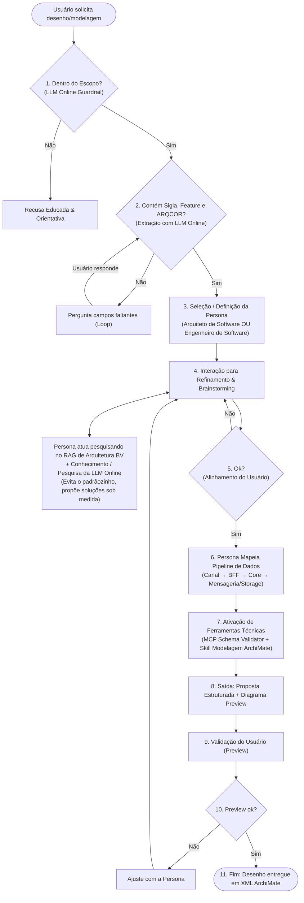

# 🏛️ Agente Arquiteto de Software · AI Architecture Designer (ArchiMate 3.2)

> **Agente Inteligente de Arquitetura de Software aderente às diretrizes corporativas do Banco BV, com observabilidade FinOps integrada em tempo real e compatível com o aplicativo desktop [Archi](https://www.archimatetool.com/).**

O sistema recebe demandas de negócio em linguagem natural, valida o escopo, interage via chat consultivo com **Personas Especialistas** (Arquiteto de Software ou Engenheiro de Software), consulta a base de conhecimento **RAG de Arquitetura BV**, projeta a esteira de dados ponta a ponta e gera o modelo oficial **ArchiMate 3.2** exportável em **XML Open Group** e **JSON**.

---

## 🧭 Fluxograma Oficial de Funcionamento

O projeto foi construído para seguir 100% o fluxo definido em [`docs/DesenhoFluxograma_V2.png`](docs/DesenhoFluxograma_V2.png):



---

## ⚙️ Principais Funcionalidades

- **🛡️ Guardrail de Escopo com LLM Online:** Classifica se o pedido está no domínio de arquitetura de software, recusando educadamente assuntos fora de escopo.
- **📋 Tríade Mandatória de Pré-requisitos:** Exige estritamente **Sigla do Projeto (4 letras)**, **Feature** e **ARQCOR**. Caso algum falte, questiona amigavelmente o usuário em loop conversacional.
- **🎭 Personas Especialistas Selecionáveis:**
  - **Arquiteto de Software:** Visão holística macro, governança, camadas corporativas ArchiMate e conformidade.
  - **Engenheiro de Software:** Detalhamento prático de protocolos, resiliência (Circuit Breakers, retries, DLQ) e contratos.
- **💡 Brainstorming Dinâmico com RAG (Sem "padrãozinho"):** A persona e o LLM Online (Gemini, OpenAI ou Ollama) pesquisam no catálogo técnico oficial e propõem soluções inovadoras sob medida.
- **🪙 Módulo de FinOps & Rastreamento de Custos Nativo na UI:** Medição rigorosa de tokens de entrada (`prompt_tokens`), saída (`completion_tokens`) e latência por etapa, calculando o custo exato em **R$** e **USD** com base na tabela de preços oficial do modelo, exibido em um **Badge e Modal interativo** na aplicação.
- **🐳 Observabilidade Containerizada (Docker + Arize Phoenix / LangGraph):** Orquestração completa via `docker-compose.yml` que sobe o Backend, o Frontend e a plataforma open-source **Arize Phoenix** na porta `6006` para rastrear grafos de execução, spans e custos sem depender de nuvens externas pagas.
- **📊 Esteira de Dados e Nomenclatura Corporativa BV:**
  - Fórmula oficial: `[sigla-tech]-[sigla-sistema]-[modulo]-[tipo]-[dominio]`.
  - Esteira completa: $\text{Canal} \rightarrow \text{BFF} \rightarrow \text{Core Atômico} \rightarrow \text{Mensageria / Storage}$.
- **🔄 Preview Interativo & Loop de Ajustes:** Visualização do diagrama SVG, validação de regras metamodelo e botão para solicitar ajustes que retornam ao refinamento com a persona.
- **💾 Exportação Oficial The Open Group XML:** Arquivo `.archimate` compatível para importação imediata no aplicativo **Archi**.

---

## 🛠️ Tecnologias Utilizadas

| Camada | Tecnologias |
|---|---|
| **Backend** | Python 3.12 / 3.10+, FastAPI, Pydantic v2, Uvicorn, Pytest |
| **Frontend** | Node.js 20+, React 19, TypeScript, Vite 6, Lucide React |
| **IA / LLM Online** | **Google Gemini** (`gemini-2.0-flash` via Google AI Studio / GCP / GCA), OpenAI (`gpt-4o-mini`), Ollama (`llama3.2`) ou Built-in Expert Engine (fallback offline) |
| **Observabilidade & FinOps** | **Módulo FinOps Nativo na UI** + **Arize Phoenix** (OpenTelemetry / LangGraph) em container Docker na porta `6006` |
| **Modelagem** | ArchiMate 3.2, The Open Group Model Exchange XML, SVG Dinâmico |
| **DevOps / Containers** | Docker, Docker Compose, Nginx Alpine |

---

## 🪙 Módulo de FinOps e Observabilidade de Custos

O projeto incorpora as melhores práticas dos **Módulos 09 (LangGraph) e 12 (LangSmith / FinOps)** do treinamento do Banco BV:

### Tabela de Precificação Oficial de Tokens
| Modelo | Entrada (Prompt / 1M tokens) | Saída (Completion / 1M tokens) | Custo Estimado por Desenho (BRL) |
|---|---|---|---|
| **Google Gemini 2.0 Flash** | \$0,10 USD | \$0,40 USD | **~ R$ 0,002 a R$ 0,006** |
| **OpenAI GPT-4o-mini** | \$0,15 USD | \$0,60 USD | **~ R$ 0,004 a R$ 0,010** |
| **Built-in Expert Engine** | Gratuito (\$0,00) | Gratuito (\$0,00) | **R$ 0,00** (Offline / Local) |
| **Ollama Local** | Gratuito (\$0,00) | Gratuito (\$0,00) | **R$ 0,00** (Hardware local) |

### Como Usar o FinOps na Interface Web
1. No cabeçalho da aplicação web, localize o botão **"🪙 FinOps: R$ 0,00..."**.
2. Clique nele para abrir o **Modal de FinOps & Observabilidade**:
   - Resumo em tempo real de **Custo em R$**, **Custo em USD**, **Tokens Totais** e **Número de Chamadas**.
   - Tabela detalhada discriminando cada etapa (`scope_guardrail`, `brainstorm_refinement`, `archimate_proposal`, `proposal_refine`), com respectiva persona, modelo, latência (ms) e valor monetário.
   - Botão para **Reiniciar Métricas** da sessão.
   - Botão de atalho para abrir o **Painel do Arize Phoenix** em container Docker (:6006).

---

## 🔑 Configuração do Google Cloud (GCA) e LLM do Google (Gemini Online)

Para utilizar o Agente Arquiteto com a **LLM Online do Google (Gemini)**, siga o passo a passo:

### 1. Obter a Chave da API (API Key)
- **Google AI Studio (Recomendado — Gratuito):** Acesse [Google AI Studio (API Keys)](https://aistudio.google.com/app/apikey), faça login com sua conta Google/GCA corporativa e clique em **"Create API Key"**. Copie a chave `AIzaSy...`.
- **Google Cloud Console (GCP / Vertex AI):** Acesse o console GCP, ative a **Generative Language API** e crie uma chave de API em *APIs e Serviços > Credenciais*.

### 2. Configurar no Arquivo `.env`
No arquivo `backend/.env` (ou na raiz para Docker):
```env
# Ativar Google Gemini Online
LLM_PROVIDER=gemini
GEMINI_API_KEY=AIzaSySuaChaveAqui123456789
GEMINI_MODEL=gemini-2.0-flash
```
*(O sistema aceita tanto `GEMINI_API_KEY` quanto `GOOGLE_API_KEY`).*

---

## 🐳 Observabilidade com Docker (Arize Phoenix & LangGraph)

Para garantir **observabilidade de ponta sem gerar custos de licença externa (como LangSmith Enterprise)**, o projeto utiliza a imagem oficial do **Arize Phoenix** (`arizephoenix/phoenix:latest`) integrada via OpenTelemetry.

### O que o Arize Phoenix Oferece
- 🌳 **Árvore de Execução & Grafos LangGraph:** Visualização nó a nó das decisões do agente.
- ⏱️ **Waterfall de Latência:** Análise de gargalos em cada etapa do raciocínio e chamadas de RAG.
- 🪙 **Breakdown de Tokens & Custo:** Contagem precisa de tokens de entrada e saída por modelo.
- 🔒 **100% Local e Privado:** Roda inteiramente na sua máquina via Docker, sem envio de dados de arquitetura para servidores de terceiros.

---

### Passo a Passo: Subindo a Observabilidade no Docker

#### Cenário 1: Subir APENAS a Observabilidade no Docker (Desenvolvimento Híbrido)
Se você prefere rodar o backend FastAPI e o frontend React diretamente no seu terminal (com hot-reload), mas quer o **Arize Phoenix** rodando no Docker para coletar os traces:

```powershell
# 1. Certifique-se de que o Docker Desktop está aberto e rodando
docker --version

# 2. Na raiz do projeto, suba apenas o container de observabilidade
docker compose up -d observability

# 3. Verifique se o container subiu corretamente
docker compose ps
```

> 📊 **Acesse o Dashboard do Phoenix em:** [http://localhost:6006](http://localhost:6006)

Para parar a observabilidade:
```powershell
docker compose stop observability
```

---

#### Cenário 2: Subir a Stack COMPLETA no Docker (Backend + Frontend + Observabilidade)
Para executar toda a solução em containers com uma única linha de comando:

```powershell
# 1. Copie o arquivo de variáveis de ambiente se ainda não configurou
cp backend/.env.example .env

# 2. Inicie todos os serviços com build das imagens
docker compose up -d --build

# 3. Acompanhe os logs dos serviços se desejar
docker compose logs -f
```

**Portas dos Serviços:**
- 💻 **Frontend Web (React + Nginx):** [http://localhost:5173](http://localhost:5173)
- ⚙️ **Backend API (FastAPI + Python 3.12):** [http://localhost:8000](http://localhost:8000) (Swagger: [http://localhost:8000/docs](http://localhost:8000/docs))
- 📊 **Arize Phoenix (Dashboard de Observabilidade):** [http://localhost:6006](http://localhost:6006)

Para parar toda a stack:
```powershell
docker compose down
```

Para reiniciar limpando volumes e recriando imagens:
```powershell
docker compose down -v
docker compose up -d --build
```

---

### Comandos Úteis do Docker para Manutenção

| Objetivo | Comando |
|---|---|
| **Ver status dos containers** | `docker compose ps` |
| **Ver logs da observabilidade** | `docker compose logs -f observability` |
| **Ver logs do backend** | `docker compose logs -f backend` |
| **Reiniciar apenas a observabilidade** | `docker compose restart observability` |
| **Derrubar e remover containers** | `docker compose down` |

---

## 🚀 Executando Localmente (Sem Docker)

### Pré-requisitos
- **Python 3.10+** (recomendado Python 3.12)
- **Node.js 18+ ou 20+** (com npm)
- **Git**

### 1. Backend (FastAPI)
```powershell
cd backend
python -m venv venv

# Ativar virtualenv:
.\venv\Scripts\Activate.ps1    # PowerShell
# ou source venv/bin/activate  # Linux/macOS

pip install -r requirements.txt
cp .env.example .env           # Configure a chave no .env se desejar

uvicorn app.main:app --reload --port 8000
```
> Ativo em: [http://127.0.0.1:8000](http://127.0.0.1:8000)

### 2. Frontend (React + Vite)
Em outro terminal:
```powershell
cd frontend
npm install
npm run dev
```
> Ativo em: [http://localhost:5173](http://localhost:5173)

---

### 3. Executar a Suíte de Testes Automatizados

O projeto conta com **26 testes automatizados** cobrindo todos os fluxos, incluindo os cálculos de FinOps:

```powershell
# Na raiz do projeto:
$env:PYTHONPATH='backend'
.\backend\venv\Scripts\python.exe -m pytest backend/tests/ -v
```

Output esperado:
```text
backend/tests/test_api.py (6 testes) PASSED
backend/tests/test_archimate_models.py (3 testes) PASSED
backend/tests/test_archimate_validator.py (4 testes) PASSED
backend/tests/test_architect_agent.py (4 testes) PASSED
backend/tests/test_exporter.py (1 teste) PASSED
backend/tests/test_finops.py (3 testes) PASSED
backend/tests/test_flowchart_adherence.py (5 testes) PASSED

============================= 26 passed in ~0.55s =============================
```

---

## 📁 Estrutura do Repositório

```text
agente-arquiteto/
├── backend/
│   ├── app/
│   │   ├── api/
│   │   │   └── routes.py              # Endpoints da API (brainstorm, analyze, refine, finops)
│   │   ├── knowledge/                 # Base de Conhecimento RAG de Domínio BV
│   │   │   ├── catalogo_tecnologias_bv.md
│   │   │   ├── padroes_nomenclatura_bv.md
│   │   │   ├── diretrizes_modelagem_archimate.md
│   │   │   └── padroes_integracao_e_pipeline.md
│   │   ├── models/
│   │   │   ├── archimate.py           # Metamodelo formal ArchiMate 3.2
│   │   │   ├── chat.py                # Modelos de requisição/resposta do chat e brainstorm
│   │   │   ├── observability.py       # Modelos de Spans, Tokens e FinOps
│   │   │   ├── persona.py             # Definição e prompts das Personas
│   │   │   └── proposal.py            # Modelos de proposta e pré-requisitos corporativos
│   │   ├── services/
│   │   │   ├── architect_agent.py     # Orquestrador do fluxo arquitetural
│   │   │   ├── architecture_rag.py    # Motor de busca RAG do Banco BV
│   │   │   ├── brainstorm_agent.py    # Agente consultivo com suporte a 'Ok?'
│   │   │   ├── cost_tracker.py        # Rastreador de tokens, custos em R$/USD e FinOps
│   │   │   ├── diagram_generator.py   # Renderizador de diagramas em SVG oficial
│   │   │   ├── exporter.py            # Exportador Open Group XML e JSON
│   │   │   ├── llm_provider.py        # Integração com Gemini, OpenAI, Ollama e Builtin
│   │   │   └── scope_guardrail.py     # Guardrail classificador de escopo
│   │   ├── config.py                  # Configurações e detecção de provedores
│   │   └── main.py                    # Inicialização do FastAPI e estáticos
│   ├── tests/                         # Suíte de testes automatizados (pytest)
│   ├── Dockerfile                     # Container backend Python 3.12
│   ├── .env.example                   # Exemplo de configuração de chaves de API
│   └── requirements.txt               # Dependências Python
│
├── frontend/
│   ├── src/
│   │   ├── components/                # Áreas A, B, C, D e FinOpsModal
│   │   ├── services/                  # Chamadas de API para o backend e FinOps
│   │   ├── types/                     # Tipos TypeScript do ArchiMate, Personas e FinOps
│   │   └── App.tsx                    # Componente principal integrando o fluxo
│   ├── Dockerfile                     # Container multi-stage (Node + Nginx)
│   ├── nginx.conf                     # Proxy reverso para /api
│   ├── package.json
│   └── vite.config.ts
│
├── docker-compose.yml                 # Orquestração: Backend + Frontend + Arize Phoenix (:6006)
├── docs/
│   ├── DesenhoFluxograma_V2.png       # Fluxograma oficial do sistema
│   ├── PLANO_IMPLEMENTACAO_AGENTE_ARQUITETO.md # Registro técnico e plano executivo
│   ├── RECOMENDACOES_INGESTAO_RAG.md  # Diretrizes de engenharia RAG
│   └── rag_knowledge_base/            # Meta-documentação do treinamento (LangGraph, MCP, etc.)
│
└── README.md                          # Este guia completo de execução
```

---

## 💡 Exemplo Rápido de Uso

1. Abra a aplicação em `http://localhost:5173`.
2. Escolha a **Persona**: *Arquiteto de Software* ou *Engenheiro de Software*.
3. Na caixa de texto da Área A, clique em **"Usar Exemplo BV"** ou digite:
   ```text
   Sigla: SESG
   Feature: Cálculo e monitoramento de risco ambiental com Spring Boot, Angular, PubSub e GCS
   ARQCOR: ARQ-2026
   ```
4. Interaja com a Persona no modo **Brainstorming**. Observe o badge no topo atualizando o consumo de **FinOps (tokens e valor em R$)** em tempo real!
5. Clique no badge **"FinOps"** para abrir o modal e auditar cada span de raciocínio.
6. Clique em **"Prosseguir para Modelagem (Ok)"** para gerar o modelo ArchiMate oficial e visualize o SVG.
7. Clique em **"Exportar XML (Archi)"** na Área D e importe no aplicativo **Archi** (`Arquivo -> Importar -> Modelo Open Exchange...`).

---

## 📜 Licença

Desenvolvido para fins educacionais e profissionais no âmbito do treinamento **AI Experts Banco BV**. Distribuído sob a licença **MIT**.
