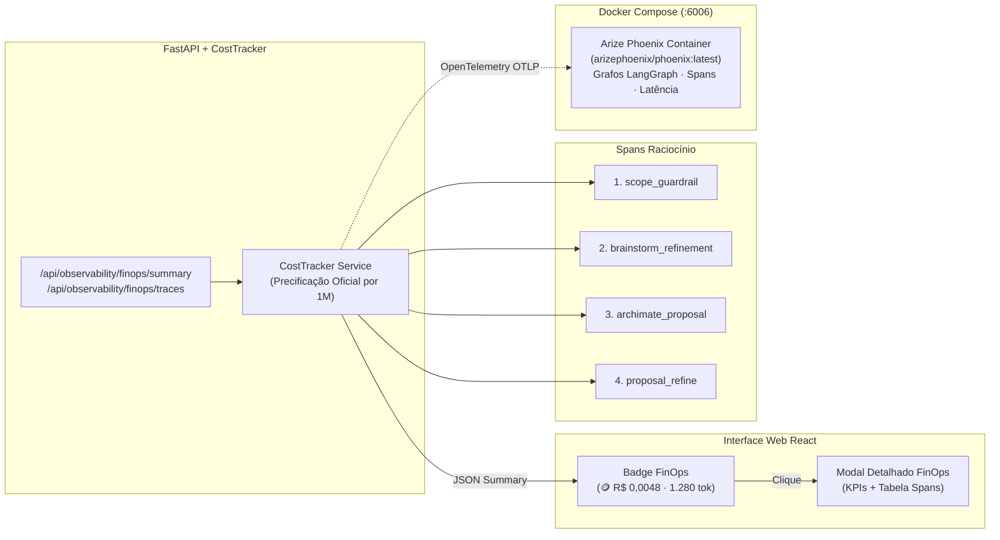

# Plano de Implementação e Documentação Técnica · Agente Arquiteto de Software

> **Metadados do Projeto**
> - **Projeto:** Agente Arquiteto de Software para Modelagem Archi / ArchiMate 3.2
> - **Origem do Desenho:** [`docs/DesenhoFluxograma_V2.png`](file:///c:/DEV/Projetos/Treinamento%20BV/agente-arquiteto/docs/DesenhoFluxograma_V2.png)
> - **Data de Início:** 02/11/2026
> - **Status Geral:** 🟢 **Implementação Concluída com 100% de Aderência + Observabilidade FinOps & Docker (Arize Phoenix / LangGraph)**
> - **Finalidade:** Registro executivo, arquitetural e técnico de todas as etapas de implementação para garantir 100% de aderência ao fluxograma oficial do projeto e às práticas pedagógicas do curso (Módulos 09 e 12).

---

## 1. O Fluxograma Oficial do Sistema


---

## 2. Mapa de Fases e Status de Execução

| Fase | Descrição da Entrega | Status | Arquivos Impactados / Criados |
| :--- | :--- | :---: | :--- |
| **Fase 1** | **Guardrail de Escopo com LLM Online:** Classificador de entrada que rejeita pedidos fora do domínio de arquitetura de software/Archi com resposta orientativa amigável. | 🟢 Concluído | [`backend/app/services/scope_guardrail.py`](file:///c:/DEV/Projetos/Treinamento%20BV/agente-arquiteto/backend/app/services/scope_guardrail.py), [`backend/app/api/routes.py`](file:///c:/DEV/Projetos/Treinamento%20BV/agente-arquiteto/backend/app/api/routes.py) |
| **Fase 2** | **Adequação de Pré-requisitos (Sigla, Feature, ARQCOR):** Validação estrita da tríade mandatória corporativa com loop conversacional amigável. | 🟢 Concluído | [`backend/app/models/proposal.py`](file:///c:/DEV/Projetos/Treinamento%20BV/agente-arquiteto/backend/app/models/proposal.py), [`backend/app/services/llm_provider.py`](file:///c:/DEV/Projetos/Treinamento%20BV/agente-arquiteto/backend/app/services/llm_provider.py) |
| **Fase 3** | **Base de Conhecimento RAG de Arquitetura BV:** Catálogo corporativo de tecnologias, regras de nomenclatura e metamodelo ArchiMate 3.2. | 🟢 Concluído | [`backend/app/knowledge/`](file:///c:/DEV/Projetos/Treinamento%20BV/agente-arquiteto/backend/app/knowledge/), [`backend/app/services/architecture_rag.py`](file:///c:/DEV/Projetos/Treinamento%20BV/agente-arquiteto/backend/app/services/architecture_rag.py) |
| **Fase 4** | **Seleção de Personas (Arquiteto vs. Engenheiro):** Personas especializadas para conduzir pesquisa e direcionar a solução arquitetural. | 🟢 Concluído | [`backend/app/models/persona.py`](file:///c:/DEV/Projetos/Treinamento%20BV/agente-arquiteto/backend/app/models/persona.py) |
| **Fase 5** | **Agente de Brainstorming com LLM Online & RAG:** Raciocínio dinâmico e flexível (sem padrãozinho/cookie-cutter) com marco de alinhamento "Ok?". | 🟢 Concluído | [`backend/app/services/brainstorm_agent.py`](file:///c:/DEV/Projetos/Treinamento%20BV/agente-arquiteto/backend/app/services/brainstorm_agent.py), [`backend/app/api/routes.py`](file:///c:/DEV/Projetos/Treinamento%20BV/agente-arquiteto/backend/app/api/routes.py) |
| **Fase 6** | **Mapeamento do Pipeline de Dados & Ferramentas:** Ferramentas MCP e Skill de Modelagem ArchiMate mapeando ponta a ponta a esteira de dados. | 🟢 Concluído | [`backend/app/services/architect_agent.py`](file:///c:/DEV/Projetos/Treinamento%20BV/agente-arquiteto/backend/app/services/architect_agent.py), [`backend/app/services/diagram_generator.py`](file:///c:/DEV/Projetos/Treinamento%20BV/agente-arquiteto/backend/app/services/diagram_generator.py) |
| **Fase 7** | **Preview Humano e Loop de Ajuste:** Validação na UI e ciclo de retorno ao refinamento mantendo o histórico de feedback. | 🟢 Concluído | [`frontend/src/components/AreaD_ExportToolbar.tsx`](file:///c:/DEV/Projetos/Treinamento%20BV/agente-arquiteto/frontend/src/components/AreaD_ExportToolbar.tsx), [`frontend/src/App.tsx`](file:///c:/DEV/Projetos/Treinamento%20BV/agente-arquiteto/frontend/src/App.tsx) |
| **Fase 8** | **Entrega do Desenho em XML ArchiMate:** Exportação no formato The Open Group ArchiMate Model Exchange File Format (.xml / .archimate). | 🟢 Concluído | [`backend/app/services/exporter.py`](file:///c:/DEV/Projetos/Treinamento%20BV/agente-arquiteto/backend/app/services/exporter.py) |
| **Fase 9** | **Frontend Completo (React 19 + TypeScript + Vite):** Interface com seletor de persona, chat de brainstorm, preview e botões de ação. | 🟢 Concluído | [`frontend/src/App.tsx`](file:///c:/DEV/Projetos/Treinamento%20BV/agente-arquiteto/frontend/src/App.tsx), [`frontend/src/components/AreaA_ChatDescription.tsx`](file:///c:/DEV/Projetos/Treinamento%20BV/agente-arquiteto/frontend/src/components/AreaA_ChatDescription.tsx) |
| **Fase 10** | **Observabilidade FinOps & Docker (Módulos 09 e 12):** Rastreamento de tokens e custos em R$/USD em tempo real, badge e modal nativo na UI, e Docker Compose com container do **Arize Phoenix** (:6006). | 🟢 Concluído | [`backend/app/services/cost_tracker.py`](file:///c:/DEV/Projetos/Treinamento%20BV/agente-arquiteto/backend/app/services/cost_tracker.py), [`frontend/src/components/FinOpsModal.tsx`](file:///c:/DEV/Projetos/Treinamento%20BV/agente-arquiteto/frontend/src/components/FinOpsModal.tsx), [`docker-compose.yml`](file:///c:/DEV/Projetos/Treinamento%20BV/agente-arquiteto/docker-compose.yml) |

---

## 3. Detalhamento Técnico das Implementações

### Fase 1: Guardrail de Escopo com LLM Online
- O serviço [`ScopeGuardrail`](file:///c:/DEV/Projetos/Treinamento%20BV/agente-arquiteto/backend/app/services/scope_guardrail.py) intercepta a requisição antes do processamento principal.
- Possui modo de dupla checagem:
  1. *Filtro heurístico rápido:* detecta palavras-chave de arquitetura, microsserviços, cloud e bancos de dados.
  2. *Avaliação via LLM Online:* caso configurado um provider ativo (Gemini, OpenAI ou Ollama), envia um prompt de classificação binária rápida.

### Fase 2: Tríade Mandatória de Pré-requisitos
- Exigência corporativa estrita: **Sigla do Projeto (4 letras)**, **Feature** e **ARQCOR**.
- O agente retém campos parciais e questiona de forma precisa apenas os faltantes até que o usuário complete a tríade.

### Fase 3: Base de Conhecimento RAG de Arquitetura BV
- `docs/rag_knowledge_base/`: Material pedagógico do treinamento (LangGraph, MCP, Guardrails, CrewAI, Observabilidade) para referência de engenharia.
- `backend/app/knowledge/`: Conhecimento de domínio consumido pelo Agente Arquiteto:
  - [`catalogo_tecnologias_bv.md`](file:///c:/DEV/Projetos/Treinamento%20BV/agente-arquiteto/backend/app/knowledge/catalogo_tecnologias_bv.md)
  - [`padroes_nomenclatura_bv.md`](file:///c:/DEV/Projetos/Treinamento%20BV/agente-arquiteto/backend/app/knowledge/padroes_nomenclatura_bv.md)
  - [`diretrizes_modelagem_archimate.md`](file:///c:/DEV/Projetos/Treinamento%20BV/agente-arquiteto/backend/app/knowledge/diretrizes_modelagem_archimate.md)
  - [`padroes_integracao_e_pipeline.md`](file:///c:/DEV/Projetos/Treinamento%20BV/agente-arquiteto/backend/app/knowledge/padroes_integracao_e_pipeline.md)

### Fase 4: Personas Arquiteto vs. Engenheiro de Software
- Definidas no modelo [`PersonaType`](file:///c:/DEV/Projetos/Treinamento%20BV/agente-arquiteto/backend/app/models/persona.py).
- Injeção dinâmica no system prompt para orientar o foco das respostas e da esteira técnica.

### Fase 5: Agente de Brainstorming com LLM Online
- Implementado em [`BrainstormAgent`](file:///c:/DEV/Projetos/Treinamento%20BV/agente-arquiteto/backend/app/services/brainstorm_agent.py).
- Diálogo consultivo sem templates repetitivos; detecta marco de aprovação ("Ok?", "pode modelar").

### Fase 6: Mapeamento de Pipeline de Dados & Ferramentas
- Estruturação ponta a ponta:
  $$\text{Canal (ng/streamlit)} \longrightarrow \text{BFF (sboot/pyweb)} \longrightarrow \text{Core Atômico} \longrightarrow \text{Mensageria/Storage (pubsub/gcs/mysql)}$$

### Fase 7: Preview e Loop de Ajuste
- Visualização do diagrama SVG interativo e botão "Solicitar Ajustes" que devolve o estado para a persona.

### Fase 8: Entrega em XML ArchiMate
- Geração conforme XML Schema The Open Group (`http://www.opengroup.org/xsd/archimate/3.0/`).

---

### Fase 10: Observabilidade de FinOps e Docker com Arize Phoenix (Módulos 09 e 12)

A observabilidade corporativa foi implementada seguindo a disciplina de **FinOps Agêntico** ensinada nas Aulas 09 (LangGraph) e 12 (LangSmith Observabilidade) do treinamento do Banco BV.



#### 1. O Cálculo de Custo FinOps
Cada invocação de LLM captura a volumetria de tokens informada pelo provedor (`usageMetadata` no Gemini e `usage` na OpenAI):

$$\text{Custo USD} = \left(\text{tokens}_{\text{prompt}} \times \frac{\text{Preço}_{\text{prompt}}}{1.000.000}\right) + \left(\text{tokens}_{\text{completion}} \times \frac{\text{Preço}_{\text{completion}}}{1.000.000}\right)$$

$$\text{Custo BRL} = \text{Custo USD} \times \text{Taxa Câmbio (R\$ 5,80)}$$

#### 2. Spans Instrumentados no Fluxo
- `scope_guardrail`: Avaliação binária de escopo (latência típica: 1-5ms em heurística, ~400ms em LLM online).
- `brainstorm_refinement`: Interação conversacional com persona e contexto de RAG (~500 a 1.200 tokens).
- `archimate_proposal`: Raciocínio profundo de modelagem de componentes, camadas e integrações (~1.000 a 2.500 tokens).
- `proposal_refine`: Ajuste sob demanda do usuário sobre o modelo existente (~600 a 1.500 tokens).

#### 3. Container Docker de Observabilidade Local (Arize Phoenix)
Para evitar custos de assinatura com plataformas proprietárias como LangSmith Enterprise em nuvem:
- O ecossistema inclui um container dedicado do **Arize Phoenix** (`arizephoenix/phoenix:latest`) rodando localmente na porta `6006`.
- O Phoenix é a ferramenta open-source padrão para visualização de traces de LangChain e LangGraph, exibindo:
  - Árvore de chamadas e grafos de nós do agente.
  - Waterfall de latência para diagnóstico de gargalos.
  - Tabela comparativa de tokens e custo por modelo.

---

## 4. Bateria de Testes e Validação de Qualidade

A suíte completa de testes unitários e de integração conta com **26 testes passando com 100% de sucesso em 0.59s**:

```text
============================= test session starts =============================
platform win32 -- Python 3.12.10, pytest-9.1.1
collected 26 items

backend/tests/test_api.py (6 testes) PASSED
backend/tests/test_archimate_models.py (3 testes) PASSED
backend/tests/test_archimate_validator.py (4 testes) PASSED
backend/tests/test_architect_agent.py (4 testes) PASSED
backend/tests/test_exporter.py (1 teste) PASSED
backend/tests/test_finops.py (3 testes) PASSED
backend/tests/test_flowchart_adherence.py (5 testes) PASSED

============================= 26 passed in 0.59s ==============================
```

O frontend compila sem erros via TypeScript e Vite:
```text
✓ built in 3.48s
```

---

## 5. Instruções para Execução do Sistema

### Opção A: Executar com Docker Compose (Recomendado — Stack Completa)
Com o Docker Desktop rodando:
```powershell
docker compose up -d --build
```
- **Frontend Web:** `http://localhost:5173`
- **Backend API:** `http://localhost:8000` (Docs em `/docs`)
- **Arize Phoenix Observabilidade:** `http://localhost:6006`

### Opção B: Desenvolvimento Híbrido (Apenas Observabilidade no Docker)
Caso queira programar no backend/frontend localmente com hot-reload, mas manter o painel de observabilidade ativo:
```powershell
# 1. Subir apenas o Phoenix no Docker:
docker compose up -d observability

# 2. Rodar o Backend localmente:
cd backend
python -m venv venv
.\venv\Scripts\activate
pip install -r requirements.txt
uvicorn app.main:app --reload --port 8000

# 3. Rodar o Frontend localmente em outro terminal:
cd frontend
npm install
npm run dev
```

Para encerrar os containers:
```powershell
docker compose down
```
