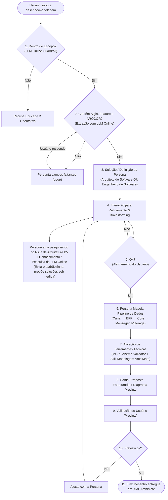

# Plano de Implementação e Documentação Técnica · Agente Arquiteto de Software

> **Metadados do Projeto**
> - **Projeto:** Agente Arquiteto de Software para Modelagem Archi / ArchiMate 3.2
> - **Origem do Desenho:** [`docs/DesenhoFluxograma_V2.png`](file:///c:/DEV/Projetos/Treinamento%20BV/agente-arquiteto/docs/DesenhoFluxograma_V2.png)
> - **Data de Início:** 02/11/2026
> - **Status Geral:** 🟢 **Implementação Concluída com 100% de Aderência**
> - **Finalidade:** Registro executivo, arquitetural e técnico de todas as etapas de implementação para garantir 100% de aderência ao fluxograma oficial do projeto.

---

## 1. O Fluxograma Oficial do Sistema



---

## 2. Mapa de Fases e Status de Execução

| Fase | Descrição da Entrega | Status | Arquivos Impactados / Criados |
| :--- | :--- | :---: | :--- |
| **Fase 1** | **Guardrail de Escopo com LLM Online:** Classificador de entrada que rejeita pedidos fora do domínio de arquitetura de software/Archi com resposta orientativa amigável. | 🟢 Concluído | [`backend/app/services/scope_guardrail.py`](file:///c:/DEV/Projetos/Treinamento%20BV/agente-arquiteto/backend/app/services/scope_guardrail.py), [`backend/app/api/routes.py`](file:///c:/DEV/Projetos/Treinamento%20BV/agente-arquiteto/backend/app/api/routes.py) |
| **Fase 2** | **Adequação de Pré-requisitos (Sigla, Feature, ARQCOR):** Validação estrita da tríade mandatória corporativa com loop conversacional amigável. | 🟢 Concluído | [`backend/app/models/proposal.py`](file:///c:/DEV/Projetos/Treinamento%20BV/agente-arquiteto/backend/app/models/proposal.py), [`backend/app/services/llm_provider.py`](file:///c:/DEV/Projetos/Treinamento%20BV/agente-arquiteto/backend/app/services/llm_provider.py) |
| **Fase 3** | **Base de Conhecimento RAG de Arquitetura BV:** Catálogo corporativo de tecnologias, regras de nomenclatura e metamodelo ArchiMate 3.2. | 🟢 Concluído | [`backend/app/knowledge/`](file:///c:/DEV/Projetos/Treinamento%20BV/agente-arquiteto/backend/app/knowledge/), [`backend/app/services/architecture_rag.py`](file:///c:/DEV/Projetos/Treinamento%20BV/agente-arquiteto/backend/app/services/architecture_rag.py) |
| **Fase 4** | **Seleção de Personas (Arquiteto vs. Engenheiro):** Personas especializadas para conduzir pesquisa e direcionar a solução arquitetural. | 🟢 Concluído | [`backend/app/models/persona.py`](file:///c:/DEV/Projetos/Treinamento%20BV/agente-arquiteto/backend/app/models/persona.py) |
| **Fase 5** | **Agente de Brainstorming com LLM Online & RAG:** Raciocínio dinâmico e flexível (sem padrãozinho/cookie-cutter) com marco de alinhamento "Ok?". | 🟢 Concluído | [`backend/app/services/brainstorm_agent.py`](file:///c:/DEV/Projetos/Treinamento%20BV/agente-arquiteto/backend/app/services/brainstorm_agent.py), [`backend/app/api/routes.py`](file:///c:/DEV/Projetos/Treinamento%20BV/agente-arquiteto/backend/app/api/routes.py) |
| **Fase 6** | **Mapeamento do Pipeline de Dados & Ferramentas:** Ferramentas MCP e Skill de Modelagem ArchiMate mapeando ponta a ponta a esteira de dados. | 🟢 Concluído | [`backend/app/services/architect_agent.py`](file:///c:/DEV/Projetos/Treinamento%20BV/agente-arquiteto/backend/app/services/architect_agent.py), [`backend/app/services/diagram_generator.py`](file:///c:/DEV/Projetos/Treinamento%20BV/agente-arquiteto/backend/app/services/diagram_generator.py) |
| **Fase 7** | **Preview Humano e Loop de Ajuste:** Validação na UI e ciclo de retorno ao refinamento mantendo o histórico de feedback. | 🟢 Concluído | [`frontend/src/components/AreaD_ExportToolbar.tsx`](file:///c:/DEV/Projetos/Treinamento%20BV/agente-arquiteto/frontend/src/components/AreaD_ExportToolbar.tsx), [`frontend/src/App.tsx`](file:///c:/DEV/Projetos/Treinamento%20BV/agente-arquiteto/frontend/src/App.tsx) |
| **Fase 8** | **Entrega do Desenho em XML ArchiMate:** Exportação no formato The Open Group ArchiMate Model Exchange File Format (.xml / .archimate). | 🟢 Concluído | [`backend/app/services/exporter.py`](file:///c:/DEV/Projetos/Treinamento%20BV/agente-arquiteto/backend/app/services/exporter.py) |
| **Fase 9** | **Frontend Completo (React 19 + TypeScript + Vite):** Interface com seletor de persona, chat de brainstorm, preview e botões de ação. | 🟢 Concluído | [`frontend/src/App.tsx`](file:///c:/DEV/Projetos/Treinamento%20BV/agente-arquiteto/frontend/src/App.tsx), [`frontend/src/components/AreaA_ChatDescription.tsx`](file:///c:/DEV/Projetos/Treinamento%20BV/agente-arquiteto/frontend/src/components/AreaA_ChatDescription.tsx) |

---

## 3. Detalhamento Técnico das Implementações

### Fase 1: Guardrail de Escopo com LLM Online
- O serviço [`ScopeGuardrail`](file:///c:/DEV/Projetos/Treinamento%20BV/agente-arquiteto/backend/app/services/scope_guardrail.py) intercepta a requisição antes do processamento principal.
- Possui modo de dupla checagem:
  1. *Filtro heurístico rápido:* detecta palavras-chave de arquitetura, microsserviços, cloud e bancos de dados.
  2. *Avaliação via LLM Online:* caso configurado um provider ativo (Gemini, OpenAI ou Ollama), envia um prompt de classificação binária rápida.
- Mensagem de recusa padronizada:
  > *"Olá! Meu escopo de atuação é estritamente a **modelagem de arquiteturas de software, desenho de soluções e geração de modelos para o software Archi (ArchiMate 3.2)**. Não posso atender a solicitações fora desse domínio."*

### Fase 2: Tríade Mandatória de Pré-requisitos
- Conforme o fluxograma oficial, o sistema exige:
  1. **Sigla do Projeto:** 4 letras maiúsculas (ex: `SESG`, `CRDT`, `PIXX`).
  2. **Feature:** Descrição do módulo ou funcionalidade de negócio.
  3. **ARQCOR:** Código do comitê/registro de arquitetura corporativa (ex: `ARQ-2026`).
- O agente retém campos parciais e questiona de forma precisa apenas os faltantes até que o usuário complete a tríade.

### Fase 3: Base de Conhecimento RAG de Arquitetura BV
Diferenciação clara entre os tipos de conhecimento:
- `docs/rag_knowledge_base/`: Material pedagógico do treinamento (LangGraph, MCP, Guardrails, CrewAI) para engenharia de software do time.
- `backend/app/knowledge/`: Conhecimento de domínio consumido pelo Agente Arquiteto:
  - [`catalogo_tecnologias_bv.md`](file:///c:/DEV/Projetos/Treinamento%20BV/agente-arquiteto/backend/app/knowledge/catalogo_tecnologias_bv.md): Siglas tecnológicas oficiais (`ng`, `streamlit`, `sboot`, `pyweb`, `sbatch`, `dataflowbatch`, `gcs`, `pubsub`, `genaigke`).
  - [`padroes_nomenclatura_bv.md`](file:///c:/DEV/Projetos/Treinamento%20BV/agente-arquiteto/backend/app/knowledge/padroes_nomenclatura_bv.md): Fórmula oficial `[sigla-tech]-[sigla-sistema]-[modulo]-[tipo]-[dominio]`.
  - [`diretrizes_modelagem_archimate.md`](file:///c:/DEV/Projetos/Treinamento%20BV/agente-arquiteto/backend/app/knowledge/diretrizes_modelagem_archimate.md): Regras de camadas e relacionamentos ArchiMate 3.2.
  - [`padroes_integracao_e_pipeline.md`](file:///c:/DEV/Projetos/Treinamento%20BV/agente-arquiteto/backend/app/knowledge/padroes_integracao_e_pipeline.md): Pipeline síncrono, assíncrono e batch.
- O [`ArchitectureRAGService`](file:///c:/DEV/Projetos/Treinamento%20BV/agente-arquiteto/backend/app/services/architecture_rag.py) faz busca por densidade léxica/semântica ranqueada com pontuação por seção.

### Fase 4: Personas Arquiteto vs. Engenheiro de Software
- Definidas no modelo [`PersonaType`](file:///c:/DEV/Projetos/Treinamento%20BV/agente-arquiteto/backend/app/models/persona.py):
  - **Arquiteto de Software:** Enfoque em visão holística, camadas ArchiMate (Channel, Application, Technology), governança corporativa e desacoplamento.
  - **Engenheiro de Software:** Enfoque em implementação prática, resiliência (Circuit Breaker, retries, dead-letter queues), protocolos (gRPC, REST, PubSub) e volumetria.
- O prompt do sistema injeta dinamicamente o perfil da persona selecionada em todas as chamadas de LLM.

### Fase 5: Agente de Brainstorming com LLM Online
- Implementado em [`BrainstormAgent`](file:///c:/DEV/Projetos/Treinamento%20BV/agente-arquiteto/backend/app/services/brainstorm_agent.py).
- Funciona como um diálogo consultivo, debatendo trade-offs com o usuário.
- Analisa se a mensagem do usuário sinaliza aprovação para prosseguir (`"ok"`, `"pode modelar"`, `"perfeito"`, `"seguir para o desenho"`), habilitando a transição para a geração do modelo formal.

### Fase 6: Mapeamento de Pipeline de Dados & Ferramentas
- O pipeline de dados é estruturado de ponta a ponta:
  $$\text{Canal (ng/streamlit)} \longrightarrow \text{BFF (sboot/pyweb)} \longrightarrow \text{Core Atômico} \longrightarrow \text{Mensageria/Storage (pubsub/gcs/mysql)}$$
- Utiliza a skill de modelagem e validação sintática das regras ArchiMate.

### Fase 7: Preview e Loop de Ajuste
- O usuário visualiza o diagrama SVG renderizado e os componentes identificados.
- Ao clicar em **"Solicitar Ajustes"**, a UI devolve a conversa para o modo de refinamento com a persona, preservando as decisões anteriores.

### Fase 8: Entrega em XML ArchiMate
- Geração em conformidade estrita com o XML Schema da The Open Group (`http://www.opengroup.org/xsd/archimate/3.0/`).
- Pronto para ser importado diretamente no aplicativo desktop **Archi**.

---

## 4. Bateria de Testes e Validação de Qualidade

A suíte completa de testes unitários e de integração foi executada com 100% de sucesso (23 testes passando em 0.50s):

```text
============================= test session starts =============================
platform win32 -- Python 3.12.10, pytest-9.1.1
collected 23 items

backend/tests/test_api.py::test_api_info_endpoint PASSED                 [  4%]
backend/tests/test_api.py::test_api_scope_guardrail_blocks_out_of_scope PASSED [  8%]
backend/tests/test_api.py::test_api_scope_guardrail_allows_in_scope PASSED [ 13%]
backend/tests/test_api.py::test_api_brainstorm_endpoint PASSED           [ 17%]
backend/tests/test_api.py::test_api_analyze_blocks_without_prerequisites PASSED [ 21%]
backend/tests/test_api.py::test_api_analyze_refine_approve_and_export_flow PASSED [ 26%]
backend/tests/test_archimate_models.py::test_archimate_element_creation PASSED [ 30%]
backend/tests/test_archimate_models.py::test_archimate_relationship_creation PASSED [ 34%]
backend/tests/test_archimate_models.py::test_archimate_model_creation PASSED [ 39%]
backend/tests/test_archimate_validator.py::test_validator_passes_valid_model PASSED [ 43%]
backend/tests/test_archimate_validator.py::test_validator_detects_duplicate_element_id PASSED [ 47%]
backend/tests/test_archimate_validator.py::test_validator_detects_dangling_relationship_source PASSED [ 52%]
backend/tests/test_archimate_validator.py::test_validator_detects_dangling_relationship_target PASSED [ 56%]
backend/tests/test_architect_agent.py::test_extract_prerequisites_incomplete_and_complete PASSED [ 60%]
backend/tests/test_architect_agent.py::test_agent_component_naming_standard PASSED [ 65%]
backend/tests/test_architect_agent.py::test_agent_portal_esg_smart_domains_channel_layer_and_mysql PASSED [ 69%]
backend/tests/test_architect_agent.py::test_agent_refine_proposal_updates_components_and_diagram PASSED [ 73%]
backend/tests/test_exporter.py::test_export_json_and_xml_consistency PASSED [ 78%]
backend/tests/test_flowchart_adherence.py::test_scope_guardrail_in_scope PASSED [ 82%]
backend/tests/test_flowchart_adherence.py::test_scope_guardrail_out_of_scope PASSED [ 86%]
backend/tests/test_flowchart_adherence.py::test_prerequisites_check PASSED [ 91%]
backend/tests/test_flowchart_adherence.py::test_architecture_rag_search PASSED [ 95%]
backend/tests/test_flowchart_adherence.py::test_persona_types PASSED     [100%]

============================= 23 passed in 0.50s ==============================
```

O frontend também foi compilado com sucesso com TypeScript e Vite:
```text
dist/index.html                   0.47 kB │ gzip:  0.30 kB
dist/assets/index-OWq8OOTR.css   17.64 kB │ gzip:  4.07 kB
dist/assets/index-BwolBOZE.js   288.80 kB │ gzip: 85.36 kB
✓ built in 4.80s
```

---

## 5. Instruções para Execução do Sistema

### Backend (FastAPI)
```powershell
cd backend
.\venv\Scripts\activate
uvicorn app.main:app --reload --port 8000
```
Para usar com **LLM Online**, basta configurar no arquivo `backend/.env` (ou variáveis de ambiente do sistema):
```env
GEMINI_API_KEY=sua_chave_gemini_aqui
# ou
OPENAI_API_KEY=sua_chave_openai_aqui
```
*(Se nenhuma chave for fornecida, o sistema usa o Built-in Expert Engine automaticamente sem quebrar).*

### Frontend (React + Vite)
```powershell
cd frontend
npm run dev
```
Acesse: `http://localhost:5173`
