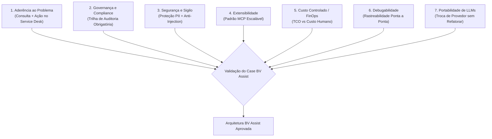
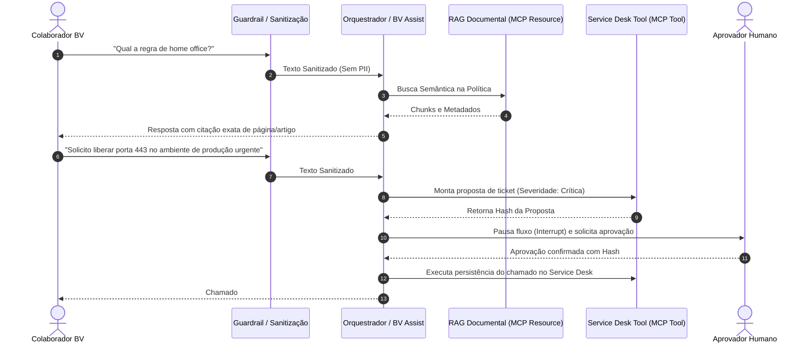

# Visão Geral, Arquitetura e o Caso Integrador BV Assist

> **Metadados RAG**
> - **Módulo:** Projeto Integrador / Visão Estratégica (Módulos 3 e 4)
> - **Tema:** Caso Integrador BV Assist, Governança Bancária, FinOps e Critérios de Decisão
> - **Palavras-chave:** BV Assist, Governança, FinOps, TCO, Service Desk, Políticas Internas, Human-in-the-Loop, Critérios de Decisão, Onboarding, Auditoria

---

## 1. Contexto de Negócio e a Dor no Ambiente Bancário

Em grandes instituições financeiras como o Banco BV, **o conhecimento corporativo existe em abundância, porém encontra-se disperso e inacessível**. 

Políticas de crédito, regras de compliance, manuais de RH e diretrizes de segurança da informação estão armazenados em portais legados e PDFs extensos. Ao mesmo tempo, a abertura de chamados técnicos e operacionais no service desk exige que o colaborador compreenda antecipadamente categorias complexas, filas corretas e severidades precisas.

### Sintomas e Impactos no Negócio

| Sintoma Observado | Causa Raiz | Impacto Mensurável |
| :--- | :--- | :--- |
| Envio excessivo de e-mails para áreas especialistas | Dificuldade de localizar respostas já documentadas em políticas | Retrabalho contínuo das equipes de RH, Jurídico e TI |
| Chamados abertos com severidade e fila incorretas | Falta de clareza do usuário final sobre regras de atendimento | Quebra de SLAs contratuais e necessidade de triagem manual |
| Dúvidas repetitivas de onboarding | Curva de aprendizado íngreme para novos funcionários | Fricção no onboarding e perda de horas de colaboradores sêniores |
| Falta de rastreabilidade | Consultas informais por chat ou e-mail sem registro | Ausência de trilha de auditoria para compliance e auditoria interna |

---

## 2. Os 7 Critérios Objetivos de Seleção do Case

A seleção do **BV Assist** seguiu 7 critérios técnicos e de negócio para garantir que a arquitetura representasse um desafio de engenharia real em ambiente regulado:

1. **Aderência ao Problema:** O agente não pode ser um mero chatbot de perguntas e respostas (Q&A). Ele deve ser capaz de consultar bases documentais com groundedness e **executar ações transacionais** (abrir tickets, propor alterações).
2. **Governança:** Por operar em um banco regulado (BACEN/CVM), cada recomendação, transição de estado e ferramenta executada deve produzir uma trilha de auditoria persistida.
3. **Segurança:** O sistema lida com dados de colaboradores e regulamentos de fundos. Exige filtragem rigorosa de PII (dados pessoais sensíveis) e contenção contra ataques de injeção de prompt (*prompt injection*).
4. **Extensibilidade:** A stack adotada (padrão aberto MCP) deve permitir que novos sistemas e fontes de dados sejam conectados sem reescrever a inteligência dos agentes.
5. **Custo Controlado (FinOps):** Alto volume diário de consultas exige otimização do custo total de propriedade (*TCO*), balanceando modelos leves locais e modelos avançados de nuvem.
6. **Debugabilidade:** Falhas em fluxos bancários exigem diagnóstico exato: inspecionar se o erro ocorreu no chunking, no embedding, na ferramenta MCP ou no raciocínio do modelo.
7. **Portabilidade:** Adoção de protocolos abertos e abstrações agênticas que evitam aprisionamento tecnológico (*vendor lock-in*).

---

## 3. Escopo Deliberadamente Delimitado do BV Assist

O BV Assist foca em **dois fluxos fundamentais executados com profundidade máxima**:

1. **Consulta de Políticas Internas (RAG Grounded):**
   - Recuperação semântica com precisão documental.
   - Respostas estritamente fundamentadas no corpus, citando a fonte e sem alucinações.
   - Identificação transparente de lacunas quando o regulamento não contém a informação solicitada.

2. **Abertura de Chamados no Service Desk:**
   - Interpretação e classificação automática de categoria e severidade.
   - **Interrupção humana obrigatória (*Human-in-the-Loop*)** para tickets de impacto crítico ou operações destrutivas.
   - Garantia de idempotência e validação criptográfica (hash) na aprovação.

---

## 4. Mapa Tecnológico do Treinamento

| Módulo Didático | Tecnologia Adotada | Responsabilidade na Arquitetura |
| :--- | :--- | :--- |
| **MCP (03, 04, 05)** | FastMCP, JSON-RPC, stdio, HTTP | Protocolo padronizado para expor políticas (*resources*) e abertura de tickets (*tools*). |
| **Google ADK (06)** | Google Agent Development Kit 2.10 | Framework para copiloto único corporativo integrando ferramentas e sessões. |
| **Segurança (07, 08)** | Presidio, Llama Guard 3, Model Armor | Sanitização prévia de PII (CPF, e-mail, telefone) e bloqueio de injeções de prompt. |
| **Orquestração (09, 10, 11)** | LangGraph | Grafos de estado dirigidos com ramificação condicional e persistência de pausas (*interrupts*). |
| **Multiagentes (10, 13)** | CrewAI & Multiagent Patterns | Arquitetura de times especializados: Triager (Triagem), Especialista (Análise) e Auditor (Juiz). |
| **Observabilidade (12)** | LangSmith | Tracing de spans, monitoramento de latência/custo de tokens e avaliação automatizada (*aevaluate*). |

---

## 5. FinOps e Análise de TCO em Ambientes Agênticos

Uma das discussões centrais do treinamento é o **Custo Total de Propriedade (TCO)** ao substituir ou apoiar tarefas humanas com agentes de IA.

$$\text{TCO Agêntico} = \text{Custo Inferência (Tokens Entrada/Saída)} + \text{Custo Infraestrutura (Embeddings/Vector DB/MCP)} + \text{Custo Governança/Observabilidade}$$

### Comparativo Econômico: Atendimento Humano vs Copiloto

| Métrica | Atendimento Humano Tradicional | BV Assist Copiloto |
| :--- | :--- | :--- |
| **Tempo Médio de Atendimento (TMA)** | 12 a 25 minutos por consulta | < 30 segundos |
| **Custo por Atendimento Médio** | R$ 15,00 a R$ 35,00 (hora analista) | R$ 0,02 a R$ 0,15 (tokens + infra) |
| **Disponibilidade** | 8x5 ou 12x5 | 24x7 |
| **Trilha de Auditoria** | Registro manual em ticket (passível de esquecimento) | 100% dos spans e decisões persistidos no LangSmith e banco |

---

## 6. Propostas de Copilotos para Projetos de Conclusão

Para os projetos finais de conclusão de curso, o treinamento sugere 4 domínios que compartilham a mesma ementa técnica (MCP, RAG, Multiagentes, Guardrails e Observabilidade):

1. **Copiloto de Onboarding e RH Interno:**
   - *Desafio:* Auxiliar novos colaboradores nos primeiros 90 dias com dúvidas sobre benefícios, férias, acesso a VPN e ferramentas.
   - *Valor Didático:* RAG sobre manuais internos + tools de solicitação de acessos com human-in-the-loop.
2. **Copiloto de Incidentes Operacionais de TI:**
   - *Desafio:* Apoiar times de sustentação N1/N2 durante incidentes de sistemas críticos.
   - *Valor Didático:* RAG sobre Runbooks + classificação de severidade + criação de chamados no Jira/ServiceNow.
3. **Copiloto de Análise de Crédito e Formalização:**
   - *Desafio:* Apoiar analistas na verificação de elegibilidade de clientes PJ/PF segundo as esteiras de crédito.
   - *Valor Didático:* Regras complexas de negócio, validação documental e aprovação humana para limites elevados.
4. **Copiloto de Prevenção a Fraude e Segurança:**
   - *Desafio:* Apoiar investigadores de segurança na correlação de alertas transacionais suspeitos.
   - *Valor Didático:* Pipeline multiagente (Triagem de Alerta → Investigação de Logs → Auditor de Bloqueio).

---

## 7. FAQ para Recuperação RAG

**P: Por que o BV Assist não foi construído como um chatbot de chat simples?**  
*R:* Porque um banco necessita de ações confiáveis no mundo real (como abrir chamados) com governança e auditoria. Um mero chatbot apenas responde textos, enquanto o BV Assist orquestra ferramentas MCP, executa validações de regras e exige aprovação humana para eventos críticos.

**P: O que acontece se o documento consultado pelo RAG não contiver a resposta?**  
*R:* O sistema possui um contrato estrito de preservação de lacunas. O agente é explicitamente proibido de inferir ou alucinar informações ausentes e deve declarar que a política não contempla o item pesquisado.

**P: Como o BV Assist garante que chamados críticos não sejam abertos automaticamente por engano do modelo?**  
*R:* Através do padrão *Human-in-the-Loop* do LangGraph. Quando um chamado de alta severidade é classificado, o fluxo é congelado (*interrupt*), gera um hash SHA-256 da proposta e aguarda confirmação explícita de um operador humano autenticado.
