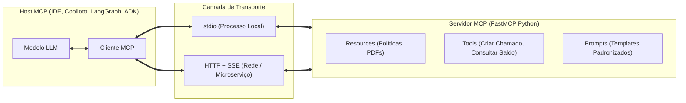

# Model Context Protocol (MCP) · Arquitetura, Servidores e Clientes

> **Metadados RAG**
> - **Módulo:** Módulo 03, 04 e 05 (MCP I, MCP II, MCP III)
> - **Tema:** Protocolo MCP, FastMCP, JSON-RPC, Ferramentas (Tools), Recursos (Resources), Prompts, Servidor e Cliente
> - **Palavras-chave:** MCP, FastMCP, Model Context Protocol, JSON-RPC, stdio, SSE, HTTP, Tools, Resources, Prompts, Inspector, MCP Store, desacoplamento

---

## 1. O que é o Model Context Protocol (MCP)?

O **Model Context Protocol (MCP)** é um padrão aberto de comunicação cliente-servidor criado para padronizar a forma como modelos de linguagem (LLMs) acessam ferramentas externas, dados e contexto corporativo.

Antes do MCP, cada framework (LangChain, CrewAI, AutoGen, LlamaIndex) implementava sua própria abstração de *tools*. Ao trocar de framework ou de provedor de modelo, era necessário reescrever todas as integrações. Com o MCP:
- **A integração é agnóstica de LLM:** O servidor MCP implementa as ferramentas e recursos uma única vez.
- **Protocolo Baseado em JSON-RPC 2.0:** Comunicação estrita com schemas tipados para requisições, respostas e notificações.
- **Fronteira de Segurança Clara:** O servidor executa em processo isolado ou contêiner, delimitando exatamente o que o modelo pode ler ou executar.



---

## 2. As Três Primitivas Principais do MCP

O protocolo define três tipos de interação padronizados:

### 1. Tools (Ferramentas)
Ações invocáveis pelo modelo de linguagem. O servidor expõe o nome da ferramenta, uma descrição semântica e um JSON Schema com os parâmetros aceitos.
- *Iniciativa:* O modelo decide quando chamar e quais argumentos passar com base na intenção do usuário.
- *Exemplo no BV Assist:* `abrir_chamado(categoria, severidade, descricao, usuario)`.

### 2. Resources (Recursos)
Fontes de dados somente-leitura expostas via URIs padronizadas (ex: `bv://politicas/home-office` ou `file:///data/regulamento.pdf`).
- *Iniciativa:* Controlada pela aplicação hospedeira ou pelo usuário para injetar contexto estruturado no prompt.
- *Exemplo no BV Assist:* Leitura de artigos de regulamentos e políticas internas.

### 3. Prompts (Templates de Prompt)
Modelos de mensagens e instruções reutilizáveis expostos pelo servidor MCP.
- *Iniciativa:* O usuário ou cliente seleciona um prompt parametrizado para guiar o comportamento do modelo em uma tarefa recorrente (ex: `/triagem-incidente`).

---

## 3. Modos de Transporte: `stdio` vs `HTTP / SSE`

O protocolo suporta dois transportes oficiais:

| Critério | Transporte `stdio` | Transporte `HTTP + SSE` (Server-Sent Events) |
| :--- | :--- | :--- |
| **Mecanismo** | Pipes de entrada e saída padrão do processo filho | Servidor HTTP ouvindo em porta TCP com streaming SSE |
| **Ambiente Típico** | Ferramentas locais da máquina, CLIs, IDEs locais | Servidores em contêineres, microserviços, redes corporativas |
| **Segurança** | Herda permissões do processo pai | Exige autenticação (Tokens, mTLS), controle de firewall |
| **Complexidade** | Simples, inicializado sob demanda | Requer manter processos servidores ativos em portas específicas |

---

## 4. Implementação Prática com FastMCP (Python)

No treinamento, a biblioteca utilizada é a **FastMCP** (especificação compatível com o ecossistema Python moderno).

### Exemplo: Servidor MCP Bancário (`servidor_mcp_bv.py`)

```python
from fastmcp import FastMCP
from pydantic import BaseModel, Field

# Inicializa o servidor FastMCP com identificador do serviço
mcp = FastMCP(
    name="BV-Assist-Server",
    instructions="Servidor MCP do Banco BV para consulta de políticas e chamados de TI"
)

# Definição de modelo Pydantic para validação de entrada da Tool
class ChamadoInput(BaseModel):
    titulo: str = Field(..., description="Título resumido do incidente")
    descricao: str = Field(..., description="Descrição detalhada do problema")
    severidade: str = Field(..., description="Severidade: baixa, media, alta ou critica")
    colaborador_email: str = Field(..., description="E-mail corporativo do solicitante")

# 1. Definindo uma TOOL (Ação executável pelo LLM)
@mcp.tool(name="abrir_chamado_servicedesk", description="Abre um chamado técnico no Service Desk do Banco BV")
def abrir_chamado_servicedesk(dados: ChamadoInput) -> dict:
    # Lógica de validação e persistência (ex: SQLite ou API ITSM)
    ticket_id = f"BV-{abs(hash(dados.titulo)) % 10000:04d}"
    return {
        "status": "sucesso",
        "ticket_id": ticket_id,
        "severidade": dados.severidade,
        "sla_horas": 4 if dados.severidade == "alta" else 24
    }

# 2. Definindo um RESOURCE (Leitura documental)
@mcp.resource("bv://politicas/{slug}")
def obter_politica(slug: str) -> str:
    """Retorna o texto integral da política corporativa solicitada."""
    politicas = {
        "ia-generativa": "Diretrizes de uso de IA Generativa: Proibido subir dados bancários sigilosos sem aprovação prévia...",
        "home-office": "Política de Trabalho Híbrido: Escala 3x2 obrigatória com registro prévio no portal..."
    }
    return politicas.get(slug, "Política não encontrada no catálogo corporativo.")

if __name__ == "__main__":
    # Executa o servidor em HTTP na porta 8875
    mcp.run(transport="http", host="127.0.0.1", port=8875)
```

---

## 5. Inspeção e Testes com MCP Inspector

Para depurar e homologar servidores MCP antes de integrá-los aos agentes, utiliza-se a ferramenta oficial da Anthropic/Linux Foundation: **MCP Inspector**.

```powershell
# Execução do Inspector oficial apontando para o servidor HTTP local
npx -y @modelcontextprotocol/inspector@2.7.0 --server-url http://127.0.0.1:8875/mcp --transport http
```

O Inspector provê uma interface web interativa para:
1. Listar todas as *tools* registradas e inspecionar seus esquemas JSON.
2. Executar chamadas manuais para as ferramentas e conferir o retorno sem envolver modelos.
3. Testar a leitura de *resources* e a renderização de *prompts*.

---

## 6. Cliente MCP em Python

Um agente ou aplicação cliente conecta-se ao servidor MCP para descobrir e invocar ferramentas dinamicamente:

```python
import asyncio
from fastmcp import Client

async def consultar_servidor():
    # Conecta ao servidor via HTTP
    async with Client(server_url="http://127.0.0.1:8875/mcp") as client:
        # 1. Descoberta dinâmica de ferramentas
        tools = await client.list_tools()
        print(f"Ferramentas disponíveis: {[t.name for t in tools]}")

        # 2. Invocação de uma ferramenta com parâmetros estruturados
        resultado = await client.call_tool(
            name="abrir_chamado_servicedesk",
            arguments={
                "dados": {
                    "titulo": "Falha de acesso à VPN",
                    "descricao": "Erro de handshake TLS ao conectar no gateway corporativo",
                    "severidade": "alta",
                    "colaborador_email": "usuario@bv.com.br"
                }
            }
        )
        print("Retorno da ferramenta:", resultado)

asyncio.run(consultar_servidor())
```

---

## 7. MCP Store: Catálogo de Ferramentas Corporativas

No **Módulo 05 (MCP III)**, introduz-se a **MCP Store** (rodando localmente em `http://127.0.0.1:8883`).
- **Objetivo:** Catálogo centralizado que agrega múltiplos servidores MCP (`servidor_mcp_bv.py` na porta 8875 e `servidor_mcp_rag.py` na porta 8876).
- **Roteamento Inteligente:** O agente consulta a Store para descobrir dinamicamente qual servidor atende cada intenção do usuário (ex: rotear dúvidas documentais para o servidor de RAG e abertura de chamados para o servidor bancário).

---

## 8. FAQ para Recuperação RAG

**P: Qual a principal diferença entre uma Tool e um Resource no MCP?**  
*R:* Uma Tool é uma ação executável pelo modelo com parâmetros dinâmicos (efeitos colaterais ou cálculos), enquanto um Resource é uma fonte de dados somente-leitura acessada via URI controlada pela aplicação para prover contexto.

**P: Por que usar FastMCP em vez de implementar JSON-RPC manualmente?**  
*R:* O FastMCP abstrai o protocolo JSON-RPC 2.0, cuida da serialização de schemas Pydantic, do ciclo de vida das conexões e suporta alternância transparente entre os transportes `stdio` e `HTTP/SSE`.

**P: Como o MCP melhora a segurança em sistemas bancários?**  
*R:* O servidor MCP atua como uma barreira rígida de permissões. O modelo não tem acesso ao banco de dados ou APIs corporativas diretamente; ele só pode emitir requisições validadas pelo schema da Tool implementada no servidor.
