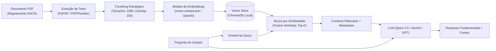

# RAG Corporativo · Indexação Semântica, Busca e Groundedness

> **Metadados RAG**
> - **Módulo:** Módulo 04 e 05 (MCP II Ollama, MCP III RAG) & Módulo 11 (BV Assist I)
> - **Tema:** RAG (Retrieval-Augmented Generation), Chunking, Embeddings, ChromaDB, Ollama, Groundedness e Lacunas
> - **Palavras-chave:** RAG, Embeddings, nomic-embed-text, ChromaDB, Qwen 2.5, Llama 3.2, KNCR, Vectorstore, top_k, Groundedness, Alucinação, Lacunas

---

## 1. O Desafio do RAG em Finanças e Ambientes Regulados

Em ambientes bancários, **a tolerância para alucinações é zero**. Uma resposta plausível, porém incorreta, sobre taxas de administração de fundos ou prazos de carência pode gerar passivos regulatórios perante a CVM/BACEN ou prejuízos financeiros aos cotistas.

Por isso, a arquitetura RAG adotada no treinamento apoia-se em três pilares fundamentais:
1. **Groundedness Estrito:** Toda afirmação na resposta gerada deve ser rastreável a um trecho literal recuperado do documento-fonte.
2. **Citação Obrigatória de Fontes:** Respostas devem incluir página, seção ou slug da política interna de onde o dado foi extraído.
3. **Preservação de Lacunas (*Gap Preservation*):** Quando o documento consultado não contém a informação, o modelo é instruído a admitir explicitamente a ausência, sendo proibido de especular ou extrapolar.

---

## 2. O Pipeline RAG de Ponta a Ponta



---

## 3. Estratégias de Chunking e Modelos de Embeddings

### O Corpus Utilizado no Treinamento
- **Documento:** Regulamento do Fundo Imobiliário KNCR (maio/2025, 40 páginas).
- **Hash de Integridade (SHA-256):** `e1efcfa1c73f5f65526fba2254f843f31f7e2e398e6a14c4e08b57d962372b8e`.

### Modelos de Embeddings Avaliados

| Provedor | Modelo | Dimensão Vetorial | Contexto de Uso |
| :--- | :--- | :--- | :--- |
| **Ollama (Local)** | `nomic-embed-text` | 768 dimensões | 100% offline, sem custo de token, ideal para privacidade bancária estrita. |
| **OpenAI (Nuvem)** | `text-embedding-3-small` | 1536 dimensões | Alta densidade semântica e excelente recuperação em textos complexos. |
| **Google (Nuvem)** | `text-embedding-004` | 768 dimensões | Integração nativa com ecossistema Google ADK e Gemini. |

### Chunking Estratégico
- **Tamanho do Chunk:** ~1000 a 1200 caracteres com overlap de 150 a 200 caracteres para preservar a continuidade de cláusulas legais e parágrafos de tabelas de taxas.
- **Enriquecimento com Metadados:** Cada fragmento no vectorstore carrega metadados com:
  - `fonte`: Nome do arquivo PDF de origem.
  - `pagina`: Número da página extraída.
  - `secao`: Título do artigo ou capítulo correspondente.

---

## 4. Implementação do RAG Core com ChromaDB (`rag_core.py`)

```python
import os
from langchain_community.document_loaders import PyPDFLoader
from langchain_text_splitters import RecursiveCharacterTextSplitter
from langchain_community.vectorstores import Chroma
from langchain_ollama import OllamaEmbeddings
from langchain_openai import OpenAIEmbeddings

def preparar_indice_vetorial(pdf_path: str, persist_dir: str, provedor: str = "ollama"):
    """Extrai, divide em chunks e indexa o documento no ChromaDB."""
    # 1. Carregamento do documento
    loader = PyPDFLoader(pdf_path)
    documentos = loader.load()

    # 2. Divisão em chunks com sobreposição
    splitter = RecursiveCharacterTextSplitter(
        chunk_size=1000,
        chunk_overlap=150,
        separators=["\n\n", "\n", "Artigo ", "§ ", ". ", " "]
    )
    chunks = splitter.split_documents(documentos)
    print(f"Total de chunks gerados: {len(chunks)}")

    # 3. Seleção do provedor de embeddings
    if provedor == "ollama":
        embeddings = OllamaEmbeddings(
            model="nomic-embed-text",
            base_url=os.getenv("OLLAMA_URL", "http://127.0.0.1:11434")
        )
    else:
        embeddings = OpenAIEmbeddings(model="text-embedding-3-small")

    # 4. Indexação no ChromaDB
    vectorstore = Chroma.from_documents(
        documents=chunks,
        embedding=embeddings,
        persist_directory=persist_dir
    )
    print("Índice vetorial preparado com sucesso!")
    return vectorstore

def recuperar_contexto(pergunta: str, vectorstore, top_k: int = 4) -> list:
    """Recupera os K chunks mais similares semanticamente."""
    retriever = vectorstore.as_retriever(search_kwargs={"k": top_k})
    documentos_recuperados = retriever.invoke(pergunta)
    return documentos_recuperados
```

---

## 5. O Impacto do Parâmetro `top_k` na Avaliação

No treinamento (especialmente nos Módulos 11 e 12), avalia-se o impacto prático de variar `top_k`:

| Configuração | Vantagens | Desvantagens / Riscos |
| :--- | :--- | :--- |
| **`top_k = 2`** | Menor consumo de tokens, menor latência, respostas mais focadas. | Risco de deixar de fora artigos regulatórios complementares distribuídos pelo documento. |
| **`top_k = 4` (Padrão)** | Equilíbrio ideal entre completude de contexto e precisão de resposta. | Custo ligeiramente superior de inferência. |
| **`top_k >= 8`** | Cobertura exaustiva de tópicos amplos. | Ruído no contexto (*needle-in-a-haystack*), aumento substancial de custo e risco de distração do modelo. |

---

## 6. O Padrão "Juiz de Suficiência" (*Sufficiency Judge*)

Antes de encaminhar os trechos recuperados para a síntese final de resposta, o sistema pode aplicar um **Juiz de Suficiência**:
- O juiz avalia: *"Os trechos recuperados respondem de forma completa e inequívoca à pergunta do usuário?"*
- **Se Sim:** Segue para o nó de geração da resposta final.
- **Se Não:** 
  1. Se a informação estiver ausente do documento, ativa o nó de **Declaração de Lacuna**.
  2. Se a recuperação tiver sido insuficiente, reformula a query para uma segunda rodada de busca.

---

## 7. FAQ para Recuperação RAG

**P: Por que o modelo Qwen 2.5 7B foi preferido ao Llama 3.2 3B no laboratório local?**  
*R:* O Llama 3.2 3B apresentou inconsistências no seguimento estrito de schemas de *tool calling* e na extração precisa de dados tabulares. O Qwen 2.5 7B demonstrou raciocínio superior para seguir contratos estruturados em português e respeitar o limite das fontes fornecidas.

**P: O que é a política de preservação de lacunas?**  
*R:* É a diretriz onde o assistente, ao não encontrar a resposta exata nos chunks recuperados (ex: divisão da parcela da taxa de administração delegada a terceiros), declara expressamente que o regulamento remete a outra fonte, sem inventar valores numéricos.

**P: Qual o papel dos metadados nos chunks do ChromaDB?**  
*R:* Os metadados permitem rastrear a origem precisa de cada frase (página, artigo, seção). Isso viabiliza que a resposta gerada mostre citações auditáveis para o usuário e para os órgãos reguladores.
