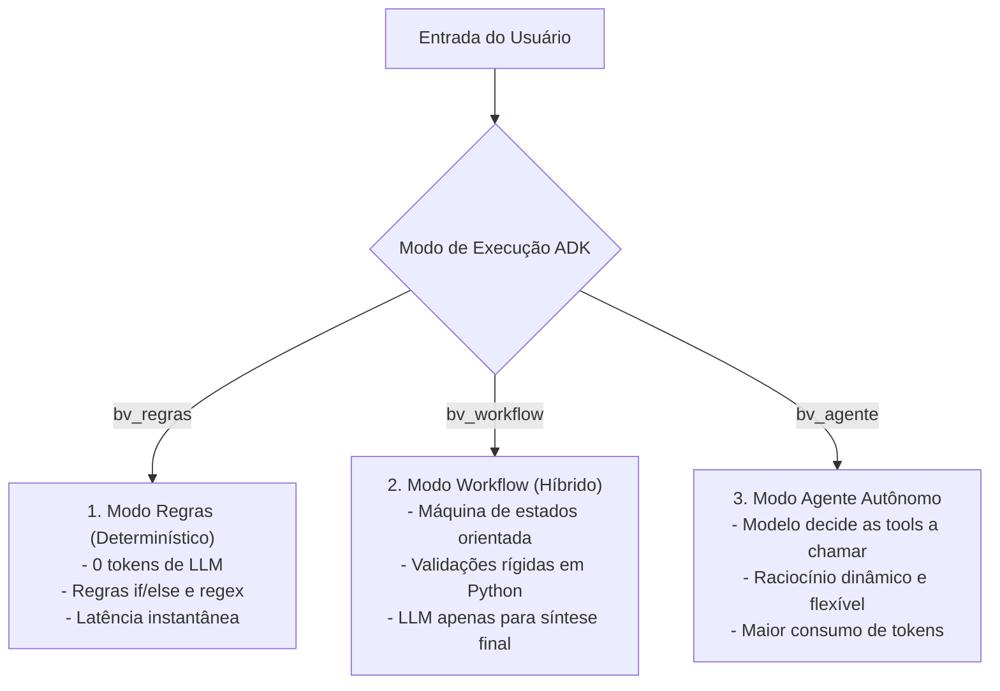

# Google Agent Development Kit (ADK) · Agentes, Sessões e Workflows

> **Metadados RAG**
> - **Módulo:** Módulo 06 (Google ADK)
> - **Tema:** Google ADK 2.10, Agentes Corporativos, Workflows Determinísticos vs Modelos, ADK Web UI, MCP
> - **Palavras-chave:** Google ADK, ADK 2.10, Gemini, Ollama, Sessions, Workflows, Runtime, bv_regras, bv_workflow, bv_agente, ADK Web

---

## 1. O que é o Google Agent Development Kit (ADK)?

O **Google Agent Development Kit (ADK)** é o framework corporativo da Google para concepção, orquestração, instrumentação e execução de agentes inteligentes autônomos.

Diferente de bibliotecas simples de prompts, o Google ADK fornece uma estrutura completa para lidar com o ciclo de vida empresarial dos agentes:
- **Separação entre Regras Determinísticas e Inferência de Modelo:** Capacidade de intercalar lógica de negócios estrita com chamadas de IA.
- **Gerenciamento de Sessão e Estado:** Rastreamento unificado de mensagens, contexto temporal e memória conversacional.
- **Interface Visual de Testes (ADK Web UI):** Painel nativo para depuração em tempo real de estados, variáveis de sessão e eventos.
- **Integração Nativa com Ferramentas e Protocolos Abertos (MCP):** Consumo transparente de ferramentas externas expostas via MCP.

---

## 2. Os Três Modos de Operação do BV Assist no ADK

No Módulo 06 do treinamento, o BV Assist foi estruturado em três variações arquiteturais para comparação de determinismo, custo e latência:



1. **`bv_regras` (Regras Estritas):**
   - Execução pura em Python com casamento de padrões (Regex / dicionários de políticas).
   - Sem custo de API, tempo de resposta determinístico (< 10 ms), ideal para perguntas frequentes padronizadas.
2. **`bv_workflow` (Processo Controlado / Híbrido):**
   - O fluxo segue etapas rígidas: Validação de Entrada → Busca Documental → Síntese com Modelo.
   - O modelo gera a redação da resposta, mas a ordem das ações é controlada rigidamente pelo código da aplicação.
3. **`bv_agente` (Agente com Tool Calling Autônomo):**
   - O LLM (Gemini 2.5/3.8 ou Ollama Qwen 2.5) recebe as ferramentas disponíveis e decide autonomamente quais invocar e com quais parâmetros.

---

## 3. Estrutura Modular de um Projeto Google ADK

A organização recomendada pelo Google ADK e utilizada no treinamento organiza as responsabilidades em:

```
projeto/
├── bv_assist_adk/
│   ├── tools/            # Ferramentas executáveis (chamados, consultas)
│   │   ├── politicas.py  # Acesso ao corpus de políticas corporativas
│   │   └── tickets.py    # Abertura e consulta de chamados
│   ├── agent.py          # Definição do agente, prompts de sistema e binds de ferramentas
│   ├── runtime.py        # Execução de ciclo de vida e gerenciamento de sessões
│   ├── workflow.py       # Definição das etapas e fluxos de estado
│   └── config.py         # Configurações de provedores (Gemini vs Ollama)
├── apps/                 # Arquivos de manifesto e apps para a interface web
├── run_local.py          # CLI para testes no terminal
└── tests/                # Testes automatizados unitários e de integração
```

---

## 4. Integração com Provedores: Gemini vs Ollama

O Google ADK 2.10 suporta tanto provedores em nuvem quanto inferência local através de abstrações de runtime configuráveis via `.env`:

```ini
# Configuração em projeto/.env
BV_ASSIST_PROVIDER=gemini   # Opções: gemini | ollama

# Credenciais Google AI Studio / Gemini
GOOGLE_API_KEY=AIzaSy...
GOOGLE_GENAI_USE_VERTEXAI=False

# Configuração Ollama Local
OLLAMA_API_BASE=http://127.0.0.1:11434
OLLAMA_MODEL=qwen2.5:7b
```

### Exemplo de Configuração de Agente no ADK (`agent.py`)

```python
from google_adk import Agent, ToolRegistry
from .tools.politicas import consultar_politica
from .tools.tickets import registrar_chamado

def criar_agente_bv(provedor: str = "gemini") -> Agent:
    """Configura o agente BV Assist com suas ferramentas corporativas."""
    registry = ToolRegistry()
    registry.register(consultar_politica)
    registry.register(registrar_chamado)

    agente = Agent(
        name="BV-Assist-ADK",
        system_instruction=(
            "Você é o assistente corporativo do Banco BV. "
            "Responda dúvidas sobre políticas internas utilizando exclusivamente as ferramentas de consulta. "
            "Para problemas técnicos, colete detalhes e utilize a ferramenta de abertura de chamados."
        ),
        tools=registry,
        provider=provedor
    )
    return agente
```

---

## 5. Interface de Desenvolvimento ADK Web UI

O ADK inclui um servidor web integrado para testes e inspeção visual:

```powershell
# Iniciar a interface web do ADK na porta 8895
.\projeto\.venv\Scripts\adk.exe web projeto/apps --host 127.0.0.1 --port 8895
```

Ao acessar **http://127.0.0.1:8895**, o desenvolvedor tem acesso a:
- Seletor de aplicações (`bv_regras`, `bv_workflow`, `bv_agente`).
- Chat interativo com renderização visual das chamadas de ferramentas e seus argumentos.
- Visualizador de eventos de sessão (*Session Events*) e variáveis de memória interna.

---

## 6. FAQ para Recuperação RAG

**P: Por que usar o modo `bv_workflow` em vez de deixar o agente 100% autônomo em `bv_agente`?**  
*R:* Em processos bancários críticos, a previsibilidade é prioridade sobre a criatividade. O `bv_workflow` garante que regras de validação e etapas obrigatórias de compliance sejam executadas sempre na ordem exata, limitando a atuação do LLM à geração de linguagem natural.

**P: Como o Google ADK consome ferramentas MCP?**  
*R:* O Google ADK oferece adaptadores para registrar clientes MCP no seu `ToolRegistry`. Assim, uma ferramenta servida em um microserviço FastMCP em Python ou TypeScript pode ser exposta diretamente ao agente Google ADK como uma função nativa.

**P: É possível rodar o Google ADK sem chaves de API pagas?**  
*R:* Sim. Configurando o `BV_ASSIST_PROVIDER=ollama`, o ADK utiliza a API local compatível do Ollama rodando modelos como `qwen2.5:7b`, permitindo desenvolvimento e testes 100% desconectados da internet.
