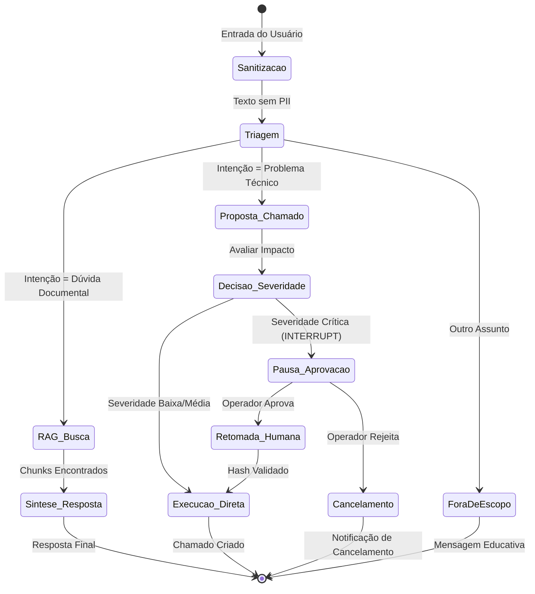

# LangGraph · Grafos de Estado, Memória e Human-in-the-Loop

> **Metadados RAG**
> - **Módulo:** Módulo 09 (LangGraph Fundamentos) e Módulo 11 (BV Assist Multiagente)
> - **Tema:** LangGraph, StateGraph, Nós, Arestas Condicionais, Checkpointers, Human-in-the-Loop, Interrupts
> - **Palavras-chave:** LangGraph, StateGraph, Nós, Edges, Conditional Edges, Checkpointer, SqliteSaver, MemorySaver, Human-in-the-Loop, Interrupt, Pausa, Retomada

---

## 1. Por que LangGraph? De Cadeias Lineares (DAGs) a Grafos Cíclicos

Em fluxos agênticos avançados, cadeias lineares estritas (como as antigas Chains do LangChain) são insuficientes. Agentes reais exigem:
- **Ciclos e Loops:** Capacidade de tentar novamente, auto-corrigir respostas, refinar buscas se a primeira tentativa for insatisfatória.
- **Roteamento Condicional Dinâmico:** Decidir o próximo nó com base em regras de negócio ou na saída de um modelo classificador.
- **Persistência de Estado (Stateful Execution):** Capacidade de suspender a execução no meio do processo, salvar no disco/banco, aguardar a aprovação de um ser humano e retomar do mesmo ponto.

O **LangGraph** resolve esses desafios modelando fluxos como **Máquinas de Estado Dirigidas (State Graphs)**.

---

## 2. Conceitos Centrais do LangGraph



1. **Estado (`State`):** Dicionário tipado (`TypedDict` ou `BaseModel`) compartilhado por todos os nós do grafo. Cada nó lê o estado e retorna apenas as chaves que deseja atualizar.
2. **Nós (`Nodes`):** Funções Python (síncronas ou assíncronas) que executam ações (chamar LLM, consultar banco, filtrar texto).
3. **Arestas Normais (`Edges`):** Conectam a saída de um nó diretamente à entrada de outro de forma determinística.
4. **Arestas Condicionais (`Conditional Edges`):** Avaliam o estado atual através de uma função roteadora e determinam dinamicamente qual nó será ativado em seguida.
5. **Checkpointer (Persistência):** Mecanismo que grava uma foto instantânea (*snapshot*) do estado a cada transição de nó em memória (`MemorySaver`) ou banco relacional (`SqliteSaver`).

---

## 3. Implementação Prática: Grafo de Atendimento BV Assist

Abaixo, a estrutura do grafo implementado nas aulas de LangGraph:

```python
from typing import TypedDict, Optional, Literal
from langgraph.graph import StateGraph, START, END
from langgraph.checkpoint.memory import MemorySaver

# 1. Definição do Estado Compartilhado
class EstadoAtendimento(TypedDict):
    pergunta_original: str
    pergunta_sanitizada: str
    intencao: Literal["consulta", "chamado", "fora_escopo"]
    contexto_recuperado: Optional[str]
    proposta_chamado: Optional[dict]
    hash_proposta: Optional[str]
    decisao_humana: Optional[Literal["aprovar", "rejeitar"]]
    resposta_final: str

# 2. Definição dos Nós
def no_sanitizacao(estado: EstadoAtendimento) -> dict:
    # Remove CPF e e-mail antes de qualquer inferência
    texto_limpo = estado["pergunta_original"].replace("123.456.789-00", "<CPF>")
    return {"pergunta_sanitizada": texto_limpo}

def no_triagem(estado: EstadoAtendimento) -> dict:
    pergunta = estado["pergunta_sanitizada"].lower()
    if "chamado" in pergunta or "problema" in pergunta or "erro" in pergunta:
        intencao = "chamado"
    elif "politica" in pergunta or "regra" in pergunta or "taxa" in pergunta:
        intencao = "consulta"
    else:
        intencao = "fora_escopo"
    return {"intencao": intencao}

def no_rag(estado: EstadoAtendimento) -> dict:
    # Simula busca de chunks
    return {"contexto_recuperado": "Artigo 12: A jornada de trabalho híbrido segue modelo 3x2..."}

def no_sintese(estado: EstadoAtendimento) -> dict:
    resposta = f"Conforme as políticas internas: {estado['contexto_recuperado']}"
    return {"resposta_final": resposta}

# 3. Função de Roteamento Condicional
def rotear_intencao(estado: EstadoAtendimento) -> str:
    if estado["intencao"] == "consulta":
        return "no_rag"
    elif estado["intencao"] == "chamado":
        return "no_proposta_chamado"
    return "no_fora_escopo"

# 4. Montagem do Grafo
builder = StateGraph(EstadoAtendimento)

# Adiciona nós
builder.add_node("no_sanitizacao", no_sanitizacao)
builder.add_node("no_triagem", no_triagem)
builder.add_node("no_rag", no_rag)
builder.add_node("no_sintese", no_sintese)

# Ligações
builder.add_edge(START, "no_sanitizacao")
builder.add_edge("no_sanitizacao", "no_triagem")
builder.add_conditional_edges("no_triagem", rotear_intencao)
builder.add_edge("no_rag", "no_sintese")
builder.add_edge("no_sintese", END)

# Compilação com Checkpointer
checkpointer = MemorySaver()
app = builder.compile(checkpointer=checkpointer)
```

---

## 4. O Padrão Human-in-the-Loop com Interrupções (`interrupt`)

No Módulo 11, o LangGraph é configurado para interromper a execução quando um chamado de alta severidade é proposto.

### Como funciona o Interrupt:
1. Durante a compilação do grafo, especifica-se quais nós devem pausar antes de executar:
   ```python
   app = builder.compile(
       checkpointer=checkpointer,
       interrupt_before=["no_executar_ticket_critico"]
   )
   ```
2. A aplicação executa até atingir a barreira. O LangGraph grava o estado no `SqliteSaver` associado a uma `thread_id` e devolve o controle à API:
   ```python
   config = {"configurable": {"thread_id": "sessao-colaborador-123"}}
   for evento in app.stream(dados_iniciais, config=config):
       print(evento)
   # O fluxo para automaticamente aqui se atingir a barreira!
   ```
3. A interface web do aprovador mostra os detalhes da solicitação e o hash SHA-256 da proposta.
4. Ao clicar em **Aprovar**, a aplicação retoma exatamente de onde parou:
   ```python
   # Injeta a decisão humana no estado e continua o grafo
   app.update_state(config, {"decisao_humana": "aprovar"})
   for evento in app.stream(None, config=config):
       print("Retomando:", evento)
   ```

---

## 5. Garantia de Idempotência e Auditoria

Em sistemas bancários, a retomada de fluxos deve ser **idempotente**:
- O `thread_id` garante que uma aprovação enviada duas vezes pela rede não gere dois tickets duplicados no Jira/ServiceDesk.
- O hash da proposta garante que se alguém tentar alterar o texto da solicitação durante a pausa para aprovação, a validação falha e a execução é cancelada.

---

## 6. FAQ para Recuperação RAG

**P: Qual a diferença entre `MemorySaver` e `SqliteSaver` no LangGraph?**  
*R:* O `MemorySaver` armazena o histórico e checkpoints apenas na memória RAM do processo Python (ideal para testes rápidos). O `SqliteSaver` grava os snapshots em arquivo de banco de dados SQLite persistente, permitindo que a aplicação seja reiniciada sem perder o estado de conversas pausadas aguardando aprovação humana.

**P: Como o LangGraph trata a concorrência e consistência de estado entre múltiplos nós paralelos?**  
*R:* Através de redutores (*reducers*) de estado. Quando dois nós executam em paralelo (ex: dois especialistas analisando o mesmo texto), suas saídas são combinadas usando funções declaradas no `TypedDict` (como `Annotated[list, operator.add]`), evitando que um nó sobrescreva silenciosamente os dados do outro.

**P: O que acontece se o usuário fechar a janela durante a pausa de aprovação humana?**  
*R:* O estado permanece salvo no checkpointer sob a chave `thread_id`. Quando o usuário ou o aprovador retornar (horas ou dias depois), basta invocar `app.stream(None, config={"configurable": {"thread_id": ...}})` para retomar o fluxo exatamente do ponto de suspensão.
