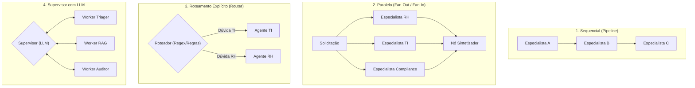

# Padrões Arquiteturais de Sistemas Multiagente e Supervisão

> **Metadados RAG**
> - **Módulo:** Módulo 10 (Multiagent Patterns)
> - **Tema:** Arquiteturas Multiagente, Padrão Supervisor, Fan-Out / Fan-In, Pipeline Sequencial, Roteamento Explícito
> - **Palavras-chave:** Multiagentes, Supervisor Pattern, Fan-Out, Fan-In, Pipeline Sequencial, Router, Especialistas, Contratos de Dados, Orquestração

---

## 1. Por que Evoluir de um Agente Único para Múltiplos Especialistas?

Em projetos corporativos, a tentativa de construir um **"Super Agente Monolítico"** (um único prompt acumulando regras de RH, TI, Segurança, Compliance e Políticas de Crédito) rapidamente esbarra em gargalos críticos:
1. **Sobrecarga de Contexto (*Prompt Bloat*):** O prompt de sistema fica gigantesco, aumentando custos de tokens e degradando a atenção do modelo.
2. **Conflito de Instruções:** Regras detalhadas de segurança competem com permissões de atendimento ao cliente, levando a comportamentos imprevisíveis.
3. **Dificuldade de Testes e Manutenção:** É impossível testar ou atualizar a política de TI sem correr o risco de quebrar a lógica de RH.

A solução da engenharia moderna de agentes é **dividir para conquistar**: decompor o problema em especialistas com **responsabilidades únicas, contratos rígidos de entrada/saída e padrões claros de orquestração**.

---

## 2. Os 5 Padrões Arquiteturais Multiagente Analisados



### Quadro Comparativo de Padrões

| Padrão | Latência | Custo de Tokens | Flexibilidade | Casos de Uso Recomendados |
| :--- | :--- | :--- | :--- | :--- |
| **1. Agente Monolítico** | Baixa a Média | Médio | Muito Baixa | Tarefas triviais de perguntas e respostas em domínio único. |
| **2. Sequencial (Pipeline)** | Alta (Soma dos tempos) | Previsível | Baixa | Fluxos lineares onde a etapa N depende estritamente do artefato da etapa N-1. |
| **3. Paralelo (Fan-Out / Fan-In)** | Baixa (Tempo do maior nó) | Alto (Chamadas simultâneas) | Média | Auditorias multidimensionais (ex: avaliar um contrato sob ótica Jurídica, Fiscal e Segurança ao mesmo tempo). |
| **4. Roteamento Explícito** | Mínima | Baixo | Alta | Atendimentos com categorias mutuamente exclusivas e bem definidas. |
| **5. Supervisor com LLM** | Mais Alta | Mais Alto | Máxima | Casos complexos e dinâmicos onde o plano de ação só pode ser traçado passo a passo. |

---

## 3. O Padrão Supervisor em Detalhes

No Módulo 10, estuda-se o **Padrão Supervisor**:
- O **Supervisor** é um nó central orquestrador alimentado por um LLM.
- Ele conhece os "currículos" e contratos de cada trabalhador (*worker*).
- A cada iteração, o Supervisor avalia o que já foi produzido e decide qual especialista deve agir em seguida, ou se o processo atingiu maturidade suficiente para a **Síntese Final**.

```python
from typing import Literal
from pydantic import BaseModel, Field

class DecisaoSupervisor(BaseModel):
    proximo_passo: Literal["especialista_ti", "especialista_rh", "auditor_compliance", "finalizar"] = Field(
        ...,
        description="Escolhe o especialista que deve executar o próximo trabalho ou indica que a tarefa está pronta."
    )
    justificativa: str = Field(..., description="Motivo da delegação para trilha de auditoria.")

def no_supervisor(estado) -> dict:
    """O modelo supervisor analisa o estado corrente e escolhe a próxima transição."""
    prompt = (
        f"Histórico e pareceres já coletados: {estado.get('pareceres', {})}\n"
        f"Dúvida do usuário: {estado['pergunta']}\n"
        "Com base nos pareceres acima, decida o próximo agente a atuar ou finalize."
    )
    # Chamada com Structured Outputs
    decisao = llm_estruturado.invoke(prompt)
    return {"proximo": decisao.proximo_passo, "historico_decisoes": [decisao.model_dump()]}
```

---

## 4. Contratos de Dados entre Especialistas

Um erro comum em implementações amadoras de multiagentes é passar texto livre desestruturado entre nós. No padrão adotado pelo Banco BV:
- Cada especialista deve responder seguindo um **Schema Pydantic tipado**.
- O contrato força a separação entre:
  1. `fato_identificado`: Trecho factual retirado do contexto documental.
  2. `analise_tecnica`: Interpretação profissional do especialista.
  3. `confianca`: Nível de certeza (Alta, Média, Baixa).
  4. `fontes_citadas`: Lista explícita de referências (artigos, páginas).

Essa disciplina garante que o nó sintetizador não receba alucinações empacotadas como se fossem fatos.

---

## 5. FAQ para Recuperação RAG

**P: Quando devo usar o padrão Fan-Out/Fan-In em vez do Supervisor?**  
*R:* Quando os domínios de análise são independentes entre si e você sabe com antecedência quais especialistas devem atuar (ex: analisar um código sob as perspectivas de performance, segurança e estilo). O Fan-Out dispara todos em paralelo, reduzindo drasticamente o tempo total em comparação a um Supervisor iterativo.

**P: Como evitar loops infinitos em sistemas com Supervisor?**  
*R:* Configurando um limite rígido de recursão (*recursion limit* ou contador de turnos) no grafo. Se o contador atingir o teto (ex: 5 iterações) sem que o supervisor decida por `finalizar`, o grafo direciona forçadamente para o nó de síntese com os dados já acumulados ou emite erro operacional.

**P: O que acontece se um especialista falhar ou emitir um parecer vazio?**  
*R:* Os contratos de dados preveem tratamento de exceções. O nó registrador preenche o parecer com status de erro ou lacuna declarada, permitindo que o sintetizador informe ao usuário que aquela dimensão específica não pôde ser avaliada, sem derrubar a resposta inteira.
