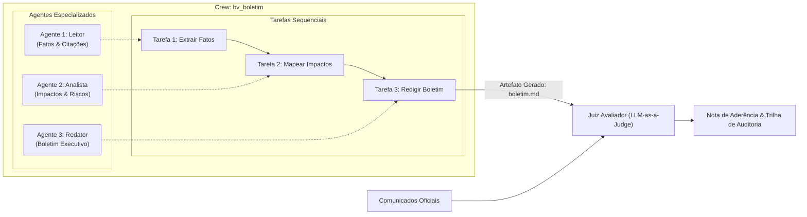
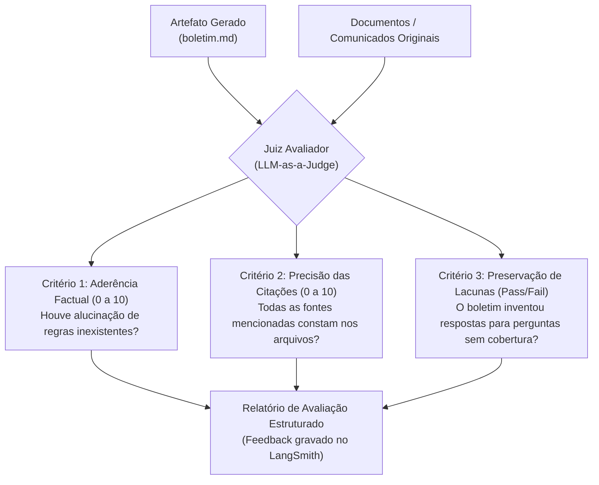

# CrewAI · Equipes Agênticas por Papéis e o Padrão Juiz Avaliador

> **Metadados RAG**
> - **Módulo:** Módulo 13 (CrewAI Observabilidade)
> - **Tema:** CrewAI 1.15, Agentes baseados em Papel (Role, Goal, Backstory), Tarefas, Processo Sequencial, Juiz Avaliador (LLM-as-a-Judge)
> - **Palavras-chave:** CrewAI, Agent, Task, Crew, Role, Goal, Backstory, Process.sequential, Process.hierarchical, Juiz Avaliador, LLM-as-a-Judge, bv_boletim

---

## 1. O que é o CrewAI e quando utilizá-lo?

O **CrewAI** é um framework projetado para orquestrar **equipes de agentes de IA colaborativos que operam como profissionais humanos com papéis bem delineados**.

Enquanto o LangGraph modela grafos de controle e máquinas de estados rígidas, o CrewAI se destaca em:
- **Fluxos colaborativos baseados em personas:** Agentes possuem especialidade, objetivo e histórico de atuação definidos.
- **Delegação e divisão de trabalho autônoma:** Um agente pode delegar sub-tarefas ou pedir esclarecimentos a outro agente da equipe.
- **Produção de artefatos complexos:** Geração de relatórios executivos, boletins informativos, sínteses de auditoria e análises estratégicas.

---

## 2. As Três Primitivas Centrais do CrewAI



1. **Agent (Agente):**
   - **`role` (Papel):** Cargo ou função na equipe (ex: *"Auditor de Segurança da Informação"*).
   - **`goal` (Objetivo):** Missão principal que guia suas decisões (ex: *"Garantir que nenhuma regra de compliance seja omitida"*).
   - **`backstory` (História de Fundo):** Contexto cultural e comportamental que calibra o tom, a cautela e o estilo de raciocínio.
2. **Task (Tarefa):**
   - **`description`:** Instrução clara do que deve ser produzido.
   - **`expected_output`:** Descrição do formato e padrão do entregável (ex: *"Tabela Markdown com colunas: Impacto, Severidade, Ação Obrigatória"*).
3. **Crew (A Equipe):**
   - Agrupa a lista de agentes e tarefas, determinando o processo de execução (`Process.sequential` ou `Process.hierarchical`).

---

## 3. O Caso Prático `bv_boletim` (Aula 13)

No laboratório da Aula 13, implementa-se a equipe **`bv_boletim`**, encarregada de processar comunicados sobre o uso seguro de IA no banco e gerar um boletim oficial para os colaboradores:

### Definição dos Agentes e Tarefas em Python

```python
from crewai import Agent, Task, Crew, Process
from langchain_openai import ChatOpenAI

llm = ChatOpenAI(model="gpt-5.4-mini", temperature=0.2)

# 1. Agente Leitor: Focado em extração factual
leitor = Agent(
    role="Leitor de Comunicados Corporativos",
    goal="Extrair exclusivamente fatos, prazos e diretrizes expressas nos comunicados sem emitir opiniões",
    backstory="Você é um especialista em leitura atenta e rigorosa de normas bancárias, imune a ambiguidades.",
    llm=llm,
    verbose=True
)

# 2. Agente Analista: Focado em avaliação de riscos
analista = Agent(
    role="Analista de Riscos Operacionais",
    goal="Identificar impactos para os colaboradores e sinalizar lacunas de informação nas diretrizes",
    backstory="Você é um auditor sênior de riscos e continuidade de negócios do Banco BV.",
    llm=llm,
    verbose=True
)

# 3. Agente Redator: Focado na redação executiva
redator = Agent(
    role="Redator Executivo de Comunicação Interna",
    goal="Consolidar os fatos e a análise de riscos em um boletim claro, acessível e estritamente referenciado",
    backstory="Você é jornalista corporativo focado em clareza, objetividade e síntese de relatórios regulatórios.",
    llm=llm,
    verbose=True
)

# 4. Definição das Tarefas em Cadeia
tarefa_leitura = Task(
    description="Ler os comunicados fornecidos e listar todos os fatos comprovados com suas referências.",
    expected_output="Lista com marcadores de fatos comprovados e suas fontes.",
    agent=leitor
)

tarefa_analise = Task(
    description="Analisar a lista de fatos e apontar: 1) O que os times devem fazer; 2) Riscos de não conformidade.",
    expected_output="Relatório estruturado de impactos operacionais.",
    agent=analista
)

tarefa_redacao = Task(
    description="Redigir o boletim executivo final com base estrita na leitura e na análise.",
    expected_output="Arquivo Markdown estruturado pronto para distribuição interna.",
    agent=redator,
    output_file="saida/boletim.md"
)

# 5. Criação e Execução da Equipe
equipe_boletim = Crew(
    agents=[leitor, analista, redator],
    tasks=[tarefa_leitura, tarefa_analise, tarefa_redacao],
    process=Process.sequential,
    verbose=True
)
```

---

## 4. O Padrão Juiz Avaliador (*LLM-as-a-Judge*)

Um dos pontos altos do Módulo 13 é o **Exercício do Juiz**. Após a equipe CrewAI gerar o arquivo `boletim.md`, um **Agente Juiz independente** (sem acesso à memória da Crew) é invocado para auditar a qualidade e a segurança do artefato:



### Contrato do Juiz Avaliador em Pydantic

```python
from pydantic import BaseModel, Field

class AvaliacaoJuiz(BaseModel):
    nota_aderencia_factual: int = Field(ge=0, le=10, description="Nota de 0 a 10 sobre groundedness")
    nota_citacao_fontes: int = Field(ge=0, le=10, description="Nota de 0 a 10 sobre a exatidão das citações")
    preservou_lacunas: bool = Field(description="True se o texto admitiu ausência de informação sem especular")
    alucinacoes_detectadas: list[str] = Field(default_factory=list, description="Trechos do boletim que não constam nas fontes")
    veredito_final: str = Field(description="Parecer técnico conclusivo aprovando ou reprovando o boletim")
```

---

## 5. FAQ para Recuperação RAG

**P: Qual a diferença fundamental entre LangGraph e CrewAI?**  
*R:* O LangGraph é um orquestrador de baixo nível baseado em grafos de estados e fluxos determinísticos, ideal para pipelines de engenharia com pausas (*interrupts*), checkpointers e integração direta com bancos de dados. O CrewAI é um framework de alto nível baseado em papéis (*personas*) colaborativos, excelente para tarefas criativas ou analíticas ricas que simulam equipes humanas.

**P: Por que o Juiz Avaliador não deve ser um dos membros da Crew?**  
*R:* Para garantir a **independência da auditoria**. Se o redator ou analista da própria crew atuar como juiz, ele compartilha o mesmo viés de raciocínio da tarefa anterior. Um juiz externo e desacoplado avalia estritamente o confronto entre o texto-fonte e o texto-gerado.

**P: Como rastrear execuções do CrewAI no LangSmith?**  
*R:* O CrewAI suporta telemetria integrada com LangSmith. Ao configurar `LANGSMITH_TRACING=true` e importar as callbacks de observabilidade, cada agente, sub-tarefa e raciocínio intermediário (*thought process*) é registrado como uma cadeia aninhada de traces e spans no painel do LangSmith.
