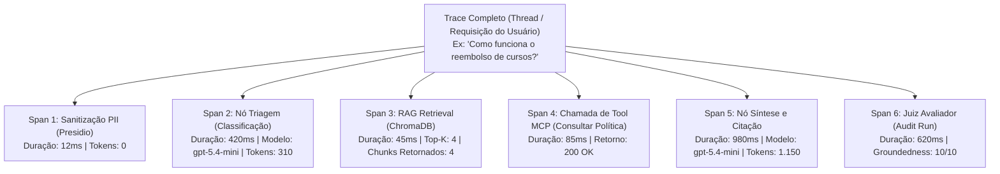
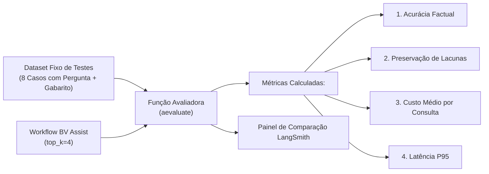

# Observabilidade, Avaliações e Métricas com LangSmith

> **Metadados RAG**
> - **Módulo:** Módulo 12 (LangSmith Observabilidade) e Módulo 11 (Avaliação BV Assist)
> - **Tema:** Observabilidade para Agentes, LangSmith, Traces, Spans, Datasets, aevaluate, Métricas de Avaliação
> - **Palavras-chave:** LangSmith, Tracing, Spans, Runs, Latência, Tokens, aevaluate, Datasets, Groundedness, Evals, Auditoria, Feedback

---

## 1. Por que Observabilidade Tradicional (APM) não Basta para Agentes de IA?

Em sistemas convencionais, ferramentas como Datadog, Dynatrace ou Prometheus monitoram CPU, memória, latência HTTP e códigos de status (ex: 200 OK vs 500 Error).

Em sistemas baseados em Agentes e LLMs, **uma requisição com status HTTP 200 pode ser uma falha catastrófica no negócio**:
- O modelo pode responder com polidez e rapidez (latência baixa), mas **alucinando uma política interna** ou inventando um número de chamado inexistente.
- A ferramenta MCP pode ter executado com sucesso técnico, mas recebido parâmetros maliciosos ou equivocados do raciocínio do modelo.
- Um loop de reflexão não planejado pode consumir 50.000 tokens e R$ 10,00 em uma única consulta simples.

A **Observabilidade de IA (com LangSmith)** introduz rastreamento semântico profundo: inspecionar prompts exatos enviados, trechos recuperados pelo RAG, chamadas de ferramentas, decisões de roteamento, consumo granular de tokens e notas de qualidade.

---

## 2. A Hierarquia de Rastreamento: Traces, Spans e Runs



- **Trace:** A jornada ponta a ponta da requisição do colaborador, desde a entrada até a resposta renderizada na tela.
- **Span:** Cada operação individual que compõe o trace (uma consulta vetorial, uma inferência de LLM, uma chamada de ferramenta).
- **Run:** O registro detalhado de uma execução específica com inputs brutos, outputs brutos, metadados de execução, status e timestamp.

---

## 3. Configuração do LangSmith no Ambiente

No treinamento, a instrumentação é feita através de variáveis de ambiente e contextos explícitos em Python:

```ini
# Configuração em .env
LANGSMITH_TRACING=true
LANGSMITH_ENDPOINT="https://api.smith.langchain.com"
LANGSMITH_API_KEY="lsv2_pt_..."
LANGSMITH_PROJECT="bv-assist-treinamento"
```

### Ativação de Tracing Seletivo via Código (`tracing_context`)

Para evitar o envio desnecessário de chamadas de teste descartáveis ou para proteger dados sensíveis durante desenvolvimento local:

```python
from langsmith import tracing_context
from langchain_openai import ChatOpenAI

llm = ChatOpenAI(model="gpt-5.4-mini")

# Bloco com rastreamento explícito para o LangSmith
with tracing_context(project_name="bv-assist-auditoria"):
    resposta = llm.invoke("Qual a regra de trabalho híbrido do BV?")
    print(resposta.content)
```

---

## 4. Avaliações Automatizadas com Datasets e `aevaluate`

A abordagem ensinada no Módulo 12 substitui os testes "manuais" no chat por **avaliações contínuas (*Evals*)** baseadas em dados de teste pré-definidos:



### Exemplo de Script de Avaliação (`avaliacao.py`)

```python
import asyncio
from langsmith import Client, aevaluate
from langchain_openai import ChatOpenAI

client = Client()

# 1. Definindo uma função avaliadora (Custom Evaluator)
def avaliar_groundedness(run, example) -> dict:
    """Verifica se a resposta cita os artigos exigidos pelo gabarito."""
    resposta_obtida = run.outputs.get("resposta_final", "")
    fontes_esperadas = example.outputs.get("artigos_esperados", [])
    
    acertos = [artigo in resposta_obtida for artigo in fontes_esperadas]
    nota = sum(acertos) / len(fontes_esperadas) if fontes_esperadas else 1.0
    
    return {
        "key": "precisao_fontes",
        "score": nota,
        "comment": f"Encontrou {sum(acertos)} de {len(fontes_esperadas)} fontes esperadas."
    }

# 2. Execução da bateria de experimentos
async def rodar_experimento():
    resultados = await aevaluate(
        lambda inputs: {"resposta_final": "O fundo KNCR é administrado pela Intrag DTVM..."},
        data="dataset-bv-assist-v1",
        evaluators=[avaliar_groundedness],
        experiment_prefix="experimento-top-k-4",
        max_concurrency=2
    )
    print("Experimento concluído no LangSmith!")

# asyncio.run(rodar_experimento())
```

---

## 5. Comparação Científica de Experimentos

No Módulo 12, a equipe compara variações arquiteturais utilizando o mesmo dataset de teste:

| Métrica Avaliada | Experimento A (`top_k = 2`) | Experimento B (`top_k = 4`) | Decisão Arquitetural |
| :--- | :--- | :--- | :--- |
| **Precisão Factual** | 78% | **96%** | `top_k = 4` garante artigos complementares essenciais. |
| **Preservação de Lacunas** | **100%** | **100%** | Ambos respeitaram ausência de dados sem alucinar. |
| **Custo Médio de Tokens** | **450 tokens** | 820 tokens | `top_k = 2` é 45% mais barato em volume. |
| **Latência P95** | **680 ms** | 1.150 ms | `top_k = 2` responde mais rápido. |

> **Conclusão de Engenharia:** Em fluxos regulados e auditorias, adota-se o `top_k = 4` pois o ganho de precisão factual (de 78% para 96%) compensa o ligeiro aumento no custo de tokens.

---

## 6. FAQ para Recuperação RAG

**P: Como usar o LangSmith em modo 100% local e sem conexão de rede?**  
*R:* O script `run.py avaliar --local` executa as métricas e avaliações inteiramente na máquina do desenvolvedor, gerando relatórios em arquivos JSON locais dentro de `runtime/avaliacoes/`, sem efetuar upload para os servidores da nuvem do LangSmith.

**P: O que fazer se as chaves de API retornarem HTTP 403 no LangSmith?**  
*R:* Definir `LANGSMITH_TRACING=false` para que a aplicação continue executando suas chamadas de modelo e ferramentas normalmente, emitindo logs no console sem interromper o fluxo operacional pela indisponibilidade da telemetria remota.

**P: Como o LangSmith ajuda na conformidade com a LGPD?**  
*R:* Inspecionando se os spans registraram texto puro ou se o nó de sanitização do Presidio ofuscou os dados pessoais *antes* do envio para o trace do LangSmith.
